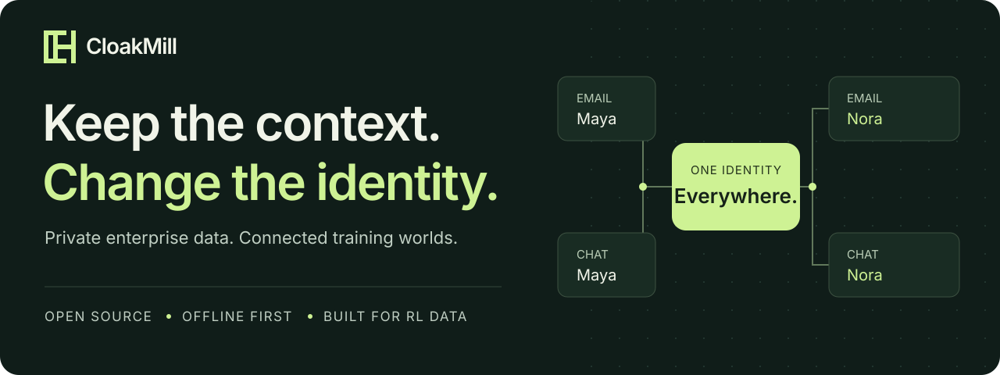
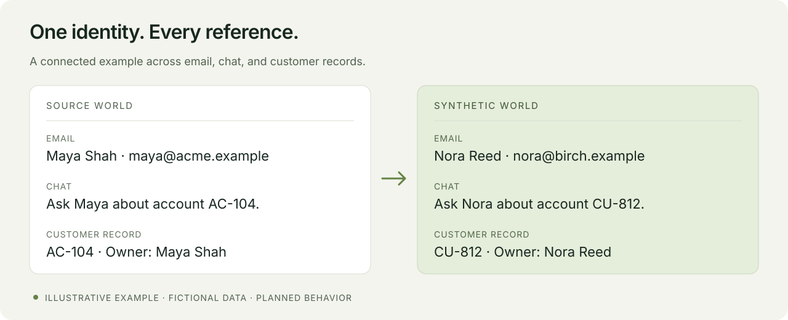

  

  <strong>Building a more useful way to prepare private enterprise data for RL training.</strong>

  
  &nbsp; <strong>Early development</strong> &nbsp; · &nbsp; <strong>Offline-first design</strong>

  <a href="#why-cloakmill">Why CloakMill</a> &nbsp; / &nbsp;
  <a href="#what-were-building">The product</a> &nbsp; / &nbsp;
  <a href="docs/ROADMAP.md">Roadmap</a> &nbsp; / &nbsp;
  <a href="CONTRIBUTING.md">Contribute</a>

---

## Why CloakMill?

Enterprise data tells a connected story. A person appears in an email, a Slack thread, a spreadsheet, and a customer record. Those connections are what make the data useful for training agents to do real work.

Blanking out every name can break that story.

**CloakMill is being built to replace sensitive identities consistently across a dataset, while preserving the context and relationships that make it useful.**

  

Illustrative example using fictional data. The transformation pipeline is not implemented yet.

## What we're building

| | Product goal |
| --- | --- |
| **One person. One consistent identity.** | Keep names, aliases, emails, and linked records aligned across sources. |
| **Context that stays connected.** | Preserve threads, relationships, references, and the workflows agents learn from. |
| **Your data stays with you.** | Run inside customer-controlled, fully offline or air-gapped infrastructure. |
| **Beyond plain text.** | Work toward support for messages, documents, spreadsheets, presentations, images, code, and databases. |
| **Repeatable dataset releases.** | Reuse approved mappings and policies across reruns and incremental imports. |
| **Evidence before export.** | Check privacy, file integrity, and RL task usefulness before releasing a dataset. |

These are design goals. See the [roadmap](docs/ROADMAP.md) for implementation status.

## Built for the people building training data

- **RL data vendors** preparing enterprise datasets for model developers.
- **Enterprise data teams** creating controlled, reusable versions of internal data.
- **Researchers and environment builders** who need realistic, connected worlds for agents.

## Where we are today

**The repository foundation is in place.** It includes the project structure, architecture, development tooling, synthetic examples, and contribution guidelines.

The first product milestone is **offline folders, structured records, and Slack/email export packages**, with consistent identity mapping and verifiable output. Connectors, transformation, a CLI, and a review application are still ahead. There is no end-user release to install yet.

→ [Follow the roadmap](docs/ROADMAP.md) &nbsp; · &nbsp; [Explore the design](docs/architecture/overview.md)

## Help shape CloakMill

Bring a difficult identity-matching case, a format edge case, an evaluation idea, or a contribution. Use fictional examples when discussing data.

Start with the [contribution guide](CONTRIBUTING.md), [developer setup](docs/development/getting-started.md), or [feature requests](https://github.com/deep-chokshi/cloakmill/issues/new?template=feature_request.yml).

## Open source, by design

Licensed under [Apache 2.0](LICENSE). Built for a community of data, privacy, and ML practitioners. [Licensing details](docs/licensing.md).

Identity replacement is pseudonymization, not a guarantee of anonymity. Sensitive facts and unique patterns require their own evaluation. CloakMill is in early development and is not ready for production data.
