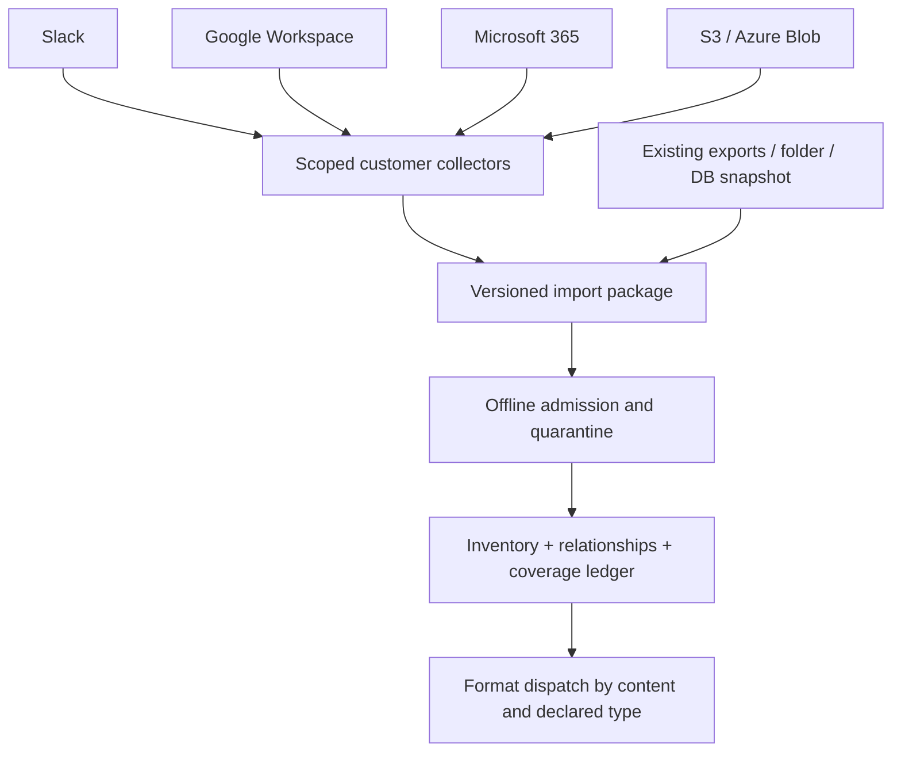
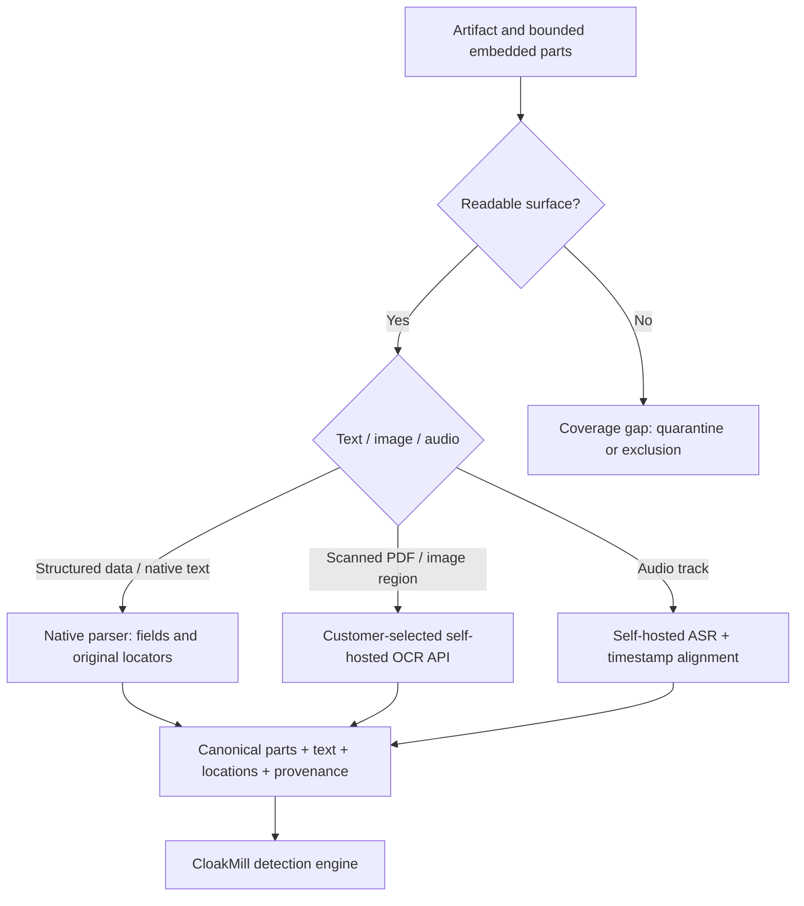
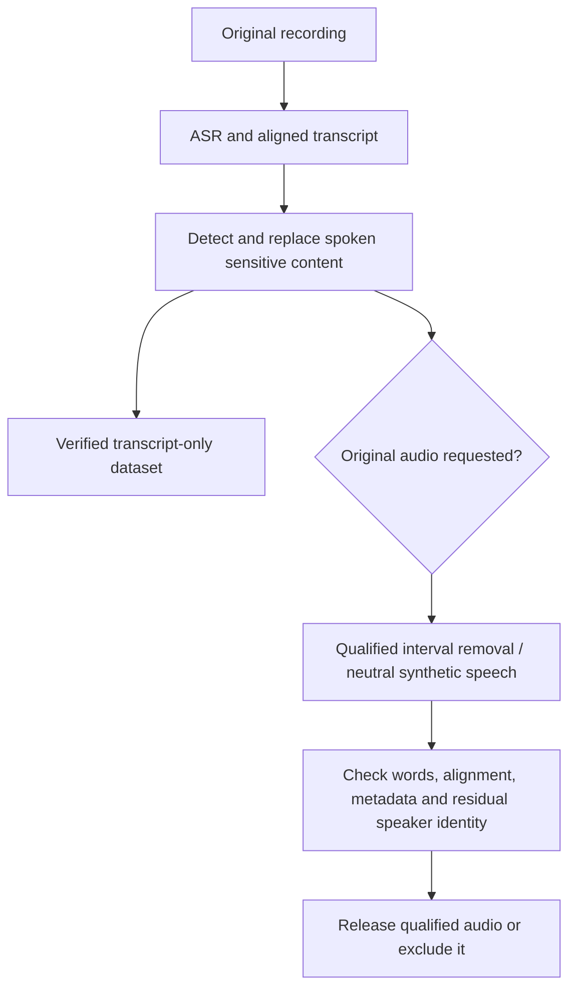

# Connectors, extraction and native formats

**Planned capabilities, not a support list.** A connector acquires source records;
a format adapter understands their contents. Neither implies that every surface
can be transformed safely. [Platform overview](overview.md).

## One acquisition contract, many sources

### Connector catalog

All rows are proposed. Scope availability depends on source permissions, retention,
licensing and export/API behavior. A connector cannot restore missing history.

| Connector | Acquisition and intended scope | Required handling and limitations |
| --- | --- | --- |
| **Slack** | Authorized export packages first; later read-only APIs for users, channels, messages, replies and available files | Preserve workspace/user/channel/message IDs and reply relationships; resolve authorized file downloads at collection time; track inaccessible channels, omitted files, edits and retention gaps. Export coverage depends on plan and authorization. Respect pagination and `Retry-After`. [Exports](https://slack.com/help/articles/201658943-Export-your-workspace-data), [API limits](https://docs.slack.dev/apis/web-api/rate-limits/) |
| **Google Workspace / G Suite** | Gmail messages and MIME attachments; Drive binaries; Docs, Sheets and Slides exports; authorized directory and metadata sidecars | Retain source IDs, revision/export selection and thread relationships. Comments/permissions/history need explicit collection; never assume they survive export. Sheets CSV export covers the first sheet only, so choose XLSX or a complete explicit strategy. [Export formats](https://developers.google.com/workspace/drive/api/guides/ref-export-formats), [Gmail sync](https://developers.google.com/workspace/gmail/api/guides/sync) |
| **Microsoft 365** | Microsoft Graph adapters for Outlook mail, OneDrive/SharePoint files and Teams messages; authorized export packages | Separate resource scopes and access checks. Teams channel-message listing excludes replies; collect them explicitly. Use delta tracking only for resources that support it; preserve opaque continuation tokens and recover from invalid tokens. [Teams messages](https://learn.microsoft.com/en-us/graph/api/channel-list-messages?view=graph-rest-1.0), [Delta query](https://learn.microsoft.com/en-us/graph/delta-query-overview) |
| **Amazon S3** | Read selected bucket/prefix and permitted object versions | Paginate listings; fetch versioned bytes where available; record private key/version metadata; distinguish current objects from historical versions and delete markers. Compute package integrity independently of ETags. [Object listing](https://docs.aws.amazon.com/AmazonS3/latest/API/API_ListObjectsV2.html), [Versions](https://docs.aws.amazon.com/AmazonS3/latest/API/API_ListObjectVersions.html) |
| **Azure Blob** | Read selected account/container/prefix and permitted versions/snapshots | Follow markers; declare whether snapshots, versions, deleted items, metadata and tags were collected. Keep access credentials out of import packages. [List Blobs](https://learn.microsoft.com/en-us/rest/api/storageservices/list-blobs) |
| **Local folders / NAS** | Read an explicitly selected root or mounted snapshot | Bound recursion and file size; block traversal and escaping symlinks; detect changes during reads; preserve relative relationships without exposing original paths in releases |
| **SQL / NoSQL / CRM snapshots** | Customer-authorized consistent exports, then dedicated snapshot adapters | Capture schemas, typed IDs, foreign keys and extraction consistency; no arbitrary SQL execution or production database write-back; declare excluded tables/collections/fields |

### Collector and import-package contract

| Contract | Required contents or behavior |
| --- | --- |
| Capability declaration | Supported source resources, version, auth method, obtainable surfaces, incremental strategy and known omissions |
| Preflight | Validate selected scope and read permissions; estimate volume; show coverage limitations before acquisition |
| Enumeration | Bounded pages, checkpoints, rate-limit backoff, cancellation and stable per-source IDs |
| Fetch | Pin source version where possible; record read window and changes; independently verify fetched bytes |
| Private manifest | Opaque artifact ID, source namespace/version, capture time, media type, internal integrity digest, relative package locator, relationships, ACL references and coverage state |
| Sidecars | Available identities/directories, ownership dates, thread/message links, comments, revisions and permission metadata, each with provenance |
| Recovery | Idempotent imports by source/version; retries do not duplicate records; expired cursors trigger a declared reconciliation/full scan |
| Package seal | Encrypted payload, signed manifest, schema version and byte counts; signatures establish provenance/integrity, not safe content |

Manifest schemas are bounded and validated. Importers check signatures, hashes,
archive expansion, nested depth, malware policy and allowed formats before
parsing. Do not fetch arbitrary URLs found in documents. Private source names,
object keys, signed URLs and integrity digests remain inside the source vault.
Different SaaS exports are not a globally atomic snapshot; retain capture windows
and surface inconsistent cross-source evidence instead of inventing consistency.

## Extraction: where OCR and speech enter

Native text is preferred where usable, but a text layer does not prove a page has
no sensitive image content. Inventory embedded and visible surfaces separately.
OCR returns text and coordinates; ASR returns text and time alignment. Neither is
an identity resolver or a sanitizer. Preserve uncertainty and source provenance.

## Format contracts: read, transform, verify

| Format family | Extract and locate | Planned output behavior and verification |
| --- | --- | --- |
| **JSON / JSONL / CSV / text** | Typed fields, row IDs, paths, exact text spans; encoding and quoting metadata | Replace values with consistent profiles; preserve schemas, escaping and joins; reject ambiguous offset/encoding changes and unsafe spreadsheet-formula cells |
| **Email / chat exports** | Headers, address fields, HTML/plain alternatives, quoted authors, threads, attachments and metadata | Rewrite every in-scope representation and relationship; inert links/credentials by policy; attachment recursion; no live mailbox send/write-back |
| **PDF** | Native text, page geometry, scanned/image regions via OCR; forms, annotations, attachments, metadata and prior revisions where present | Remove underlying sensitive objects/pixels before inserting surrogates; rebuild rather than leave recoverable incremental content. Re-extract and render; exclude unsupported surfaces or offer an explicitly qualified flattened derivative |
| **DOCX** | Paragraph runs, tables, headers/footers, comments, tracked changes, properties, relationships and embedded objects | Edit supported package parts; reconcile split runs and revisions; inspect rendered output and hidden content; no generic promise of exact layout preservation |
| **Excel / XLSX** | Cells, formulas, cached values, hidden sheets/rows, notes/comments, names, links, charts, properties and embedded objects | Update typed values and affected references; recompute or remove stale caches under policy; validate formulas and relationships; quarantine unsupported macros/legacy formats |
| **PowerPoint / PPTX** | Shapes, text runs, notes, comments, masters/layouts, charts, media, alt text and properties | Rewrite every supported surface; check text overflow, rendering and hidden content; handle unsupported embedded payloads explicitly |
| **Images** | OCR boxes, QR/barcode values, EXIF/XMP and other metadata; separate policy for faces/signatures | Replace/remove original pixels, rebuild derivative images, strip/rewrite metadata and verify by re-OCR/render inspection. Text OCR alone does not handle biometric identity |
| **Voice / audio** | ASR transcript with time spans, tracks/channels, speaker turns where supported and container metadata | Transcript-only export first. Audio release needs interval editing or neutral-voice re-synthesis, alignment and audio verification; merely changing the transcript leaves the original speech intact |
| **Video** | Audio pipeline plus frame/scene text and identifying visual surfaces | Later dedicated pipeline; OCRing a few frames cannot establish whole-video coverage. Unsupported video remains excluded |
| **Code / DB snapshots** | Syntax-aware tokens or structured fields; paths, comments, fixtures, secrets and relation keys | Preserve qualified syntax/schema behavior and relational integrity; do not execute untrusted code, macros or database procedures during extraction |

Native writing is a separate adapter from parsing. A parser returning text does
not prove that the original document can be sanitized or round-tripped.

### Audio has two different identity problems

Speaker diarization identifies turns within a recording; it does not establish a
person's identity. Removing names or replacing a few words does not de-identify
the speaker's voice. Voice conversion or re-synthesis is a separate, evaluated
capability; generation itself is not deterministic, so accepted audio is stored
as a versioned artifact. Transcripts must match the delivered audio.

## Reader and writer admission gates

For every supported format, publish a versioned feature matrix with **readable,
detectable, writable and verifiable** status per surface. A partially supported
format must report its gaps. Missing required surfaces block release of the
affected artifact; exclusions reduce the declared output scope and remain visible.

Test hidden surfaces, oversized/nested files, corrupt encodings, spoofed media
types, active content, source mutation, partial downloads and permission loss.
Parser workers run without network or macro/script execution, with CPU, memory,
file, archive-expansion and wall-time limits.
