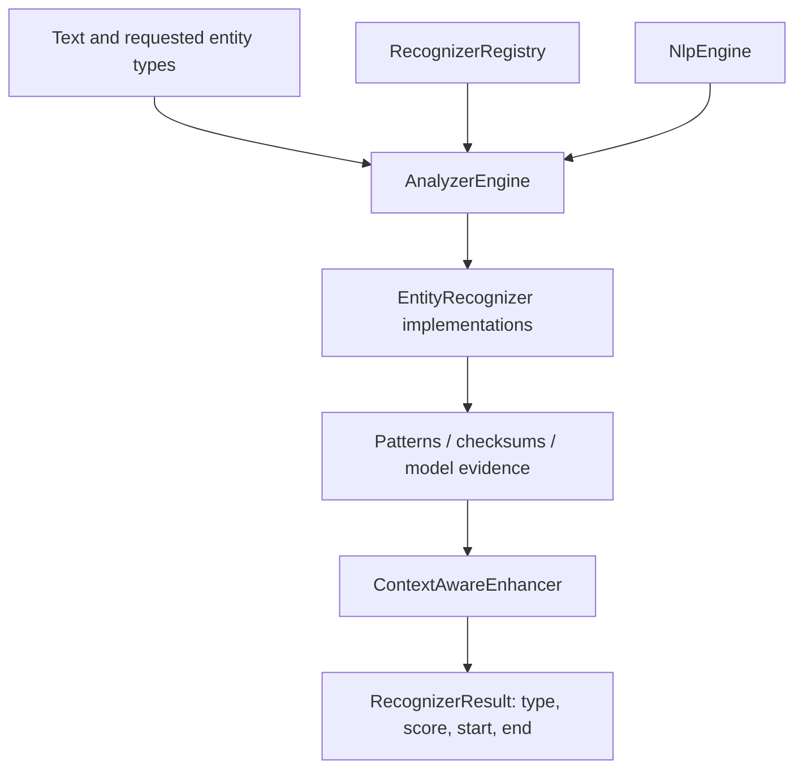
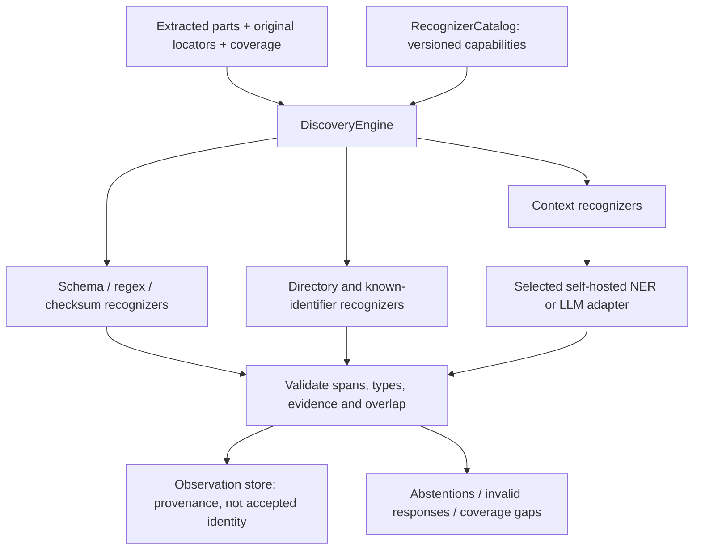
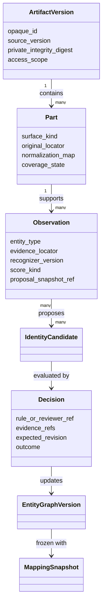
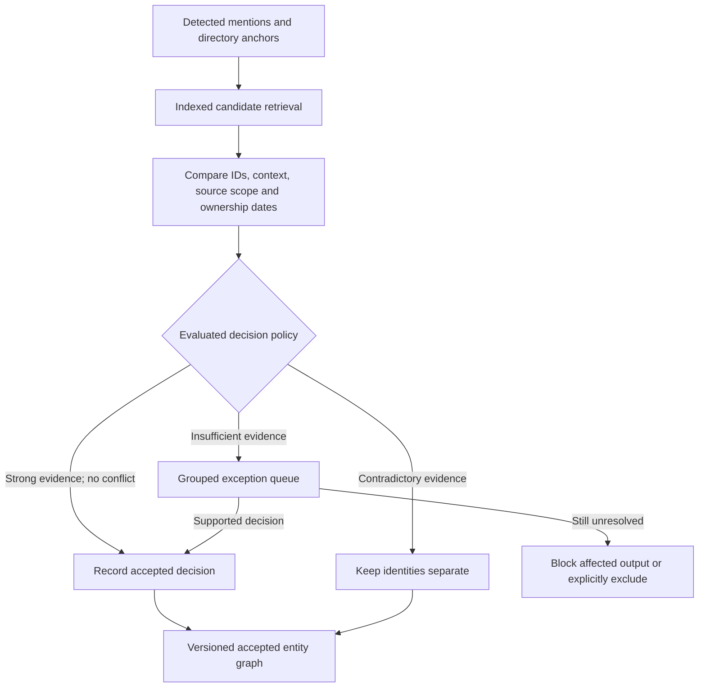

# Detection and identity: the engine we own

**Proposed architecture.** No recognizer or identity-resolution pipeline is
implemented by this document. [Platform overview](overview.md).

## What the Presidio reference illustrates

Presidio's analyzer coordinates a recognizer registry and NLP engine. Recognizers
can use patterns, checksums, context or models; results carry an entity type,
score and text offsets. Context enhancement can adjust results. The diagram below
is an original simplification of its documented concepts, not a copied product
image. See the [official Analyzer documentation](https://presidio.dataprivacystack.org/analyzer/).

This is a useful recognition pattern. CloakMill also needs source acquisition,
multimodal locators, temporal identity ownership, consistent mappings, native
writers and independent release verification. We will implement our own contracts
and policy engine, without importing Presidio or adopting its internal data model.

## CloakMill recognition architecture

| Owned component | Input → output | Boundary |
| --- | --- | --- |
| `DiscoveryEngine` | Versioned parts and policy → observations and coverage | Schedules recognizers; never invents replacement values |
| `RecognizerCatalog` | Language, type, surface and policy → enabled versioned recognizers | Rule packs are validated data; arbitrary plugins require installation review |
| `RuleRecognizer` | Field values or text → exact spans and validation evidence | Regex work limits, checksums, schema hints, false-positive exclusions |
| `DirectoryRecognizer` | Scoped directory → supported identifiers and aliases | Names and mailboxes alone do not prove a person match |
| `ContextRecognizer` | Bounded evidence → typed candidate observations | Calls the selected local API; validates responses before persistence |
| `ObservationValidator` | Candidate results → valid observations, conflicts or abstentions | Exact source/version match, locator bounds, evidence integrity; no silent overlap loss |
| `IdentityResolver` | Observations and authoritative links → candidate graph and exceptions | Keeps people, accounts, organizations and business objects distinct |
| `DecisionPolicy` | Evidence plus evaluated rules → accept, reject or review | Automatic decisions have rule/version/provenance, just as manual decisions do |

## Shared contracts

These are design contracts for `src/cloakmill/domain/`, not existing API endpoints.

Text offsets declare their unit; PDF/image locators carry page and bounding box;
Office locators carry package part and node/cell; audio locators carry track and
time interval. Every locator refers to immutable source content. Normalized
matching text never replaces the original coordinate system.

A model score, pattern match, OCR confidence and linkage probability have different
meanings. Store provenance and score kind; do not average them into a universal
"privacy confidence". Evaluations determine which signals a policy can use.

## Automatic resolution, with exceptions

- Ten thousand mentions can refer to one entity. Review a disputed link or cluster,
  and apply the supported decision to its dependent observations. Do not create one
  mandatory approval per mention or auto-accept unrelated cases in bulk.
- A stable employee ID is meaningful within its source authority and lifecycle.
  Source-local IDs, renamed users, merged tenants and recycled identifiers need
  scoped, temporal interpretation.
- Shared mailboxes and service accounts have operators or owners; they are not
  aliases of all their operators. Reassigned emails need ownership periods.
- A common name, normalized Unicode spelling, matching domain or chain of weak
  similarities is candidate evidence, not a merge rule.
- Keep contradictory constraints when clustering. A weak A–B and B–C match cannot
  override evidence that A and C are distinct. Incremental merges/splits invalidate
  affected mappings and outputs instead of rewriting old releases silently.
- Evaluate candidate retrieval recall as well as pair/cluster decisions. Fast
  filtering that drops true links merely hides errors from reviewers.

The UI should lead with detected mentions, distinct candidate entities,
automatically resolved groups, unresolved groups and source coverage. Reviewers
see evidence, why a case is exceptional, affected-artifact count and consequences.
Sample automatic results for audit and check coverage independently; a small
review queue alone is not a quality metric.

## LLM context and hallucination controls

| Before the call | After the call |
| --- | --- |
| Use permitted parts from one scoped project; cap tokens and candidates | Require a versioned schema, exact supporting spans and allowed candidate IDs |
| Include local context, author roles and ownership dates | Reject nonexistent IDs, invented evidence, invalid offsets and unsupported types |
| Split at semantic boundaries with overlap; retain original coordinates | Deduplicate proposals; preserve contradictions for policy evaluation |
| Treat source text as untrusted data; disable tools, URL fetching and embedded instructions | Never execute model text or let it set permissions, mappings or release status |
| Reserve output tokens; abstain or schedule another chunk if context exceeds budget | Persist accepted results with model/prompt/adapter versions; replay without fresh inference |

An invalid response or provider outage produces an incomplete stage. LLMs may
propose observations or relationships. They do not assign synthetic profiles,
rewrite whole documents, or independently approve a release.
See [provider selection and contracts](model-providers.md).

## First implementation and measurement

1. Generate raw CSV/JSON/TXT fixtures with 1,000 and 10,000 records, repeated people,
   ambiguity and changed ownership. Keep complete expected observations and links
   in a separate evaluation set unavailable to the processing engine.
2. Implement field/text extraction, exact-locator rule recognizers and scoped
   strong-anchor resolution. Feed actual results into the UI.
3. Add contextual providers where measured errors justify them. Test outages,
   malformed replies, multilingual text, missing evidence and replay.

Report per-type precision/recall, wrong merges, missed links, unresolved rate,
review minutes, coverage, memory and throughput. Use held-out underlying entities
and source-like variations, not only repeated templates. Larger workloads test
scaling; they do not establish privacy or real-world accuracy by themselves.
