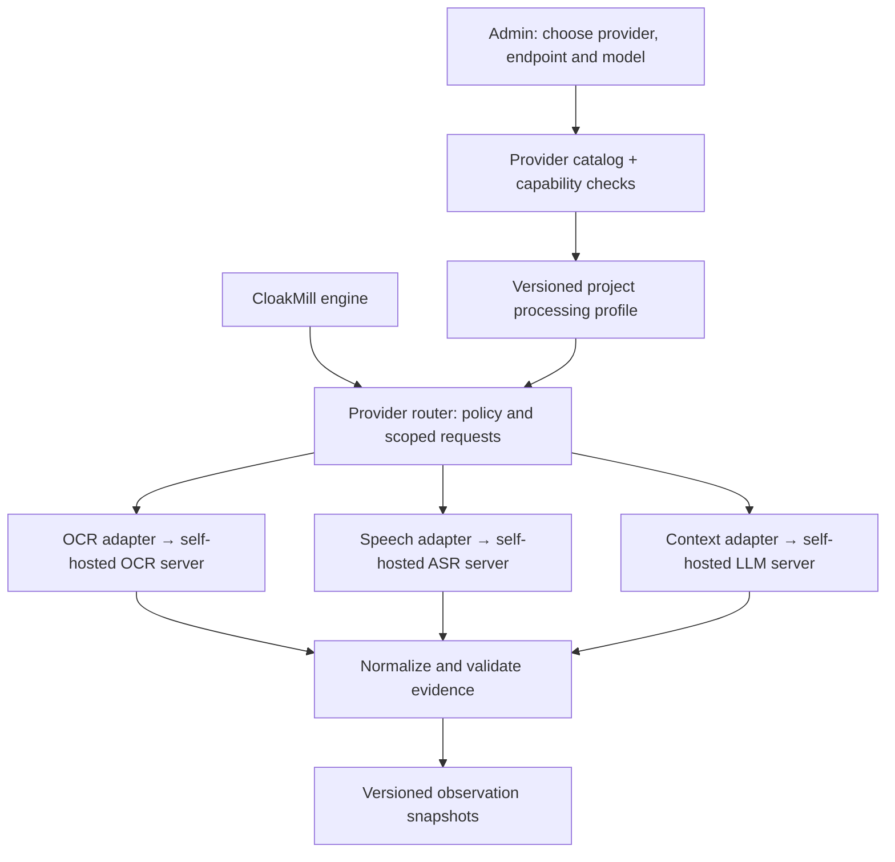

# Customer-selected, self-hosted model APIs

**Target design, not implemented integrations.** CloakMill owns the privacy
processing engine. Customers select their OCR, speech and contextual models
through private API connections. [Platform overview](overview.md).

## Ownership and selection

**API-based means customer-local service calls.** No public model API is required.
No provider is allowed to fetch model weights, send telemetry, call tools or fetch
source URLs during a processing job. The self-hosted services and their dependencies
must be installed and tested inside the customer's deployment boundary.

| CloakMill owns | Customer-selectable components |
| --- | --- |
| Recognizer registry, deterministic rules, evidence validation | OCR/layout recognition service |
| Identity matching, conflict policy and exception review | ASR/alignment service; optional speaker-turn service |
| Synthetic profiles, frozen mappings, deterministic patch plans | Contextual NER/LLM service and installed model |
| Native writer contracts, verification and release gates | Qualified parser/codec implementations and optional media synthesis service |

No SDK or model architecture is allowed to become a required domain-contract type.
Adapters translate vendor responses into CloakMill contracts. A custom endpoint
must pass contract/capability tests; an API-compatible label alone is insufficient.

## Recommended starting presets to evaluate

These are **engineering starting recommendations**, not measured CloakMill winners
or a shipped support matrix. Pin actual versions and weights when implementing an
adapter, then compare on the customer's languages, formats and hardware.

| Need | Starting preset | Alternative and selection criterion |
| --- | --- | --- |
| GPU-hosted contextual model | **vLLM** with a customer-installed instruction model and validated structured output | **llama.cpp server** for quantized models and smaller/CPU-capable deployments; evaluate schema adherence, evidence accuracy, context limit and throughput |
| OCR and document layout | **PaddleOCR service** as the first document-oriented candidate | **Tesseract behind a local API wrapper** for a lighter printed-text baseline; compare languages, rotations, scans, tables and locator quality |
| Speech recognition | **Whisper-based self-hosted service** as a baseline | Any adapter providing evaluated transcript and alignment output; compare accents, languages, noise, overlaps and timestamp errors |
| Strict rules-only operation | CloakMill's own schema/pattern/checksum recognizers | No model call; label unsupported contextual, visual and audio surfaces as incomplete rather than pretending equivalent coverage |

vLLM documents [online API serving](https://docs.vllm.ai/en/latest/serving/online_serving/)
and [structured outputs](https://docs.vllm.ai/en/latest/features/structured_outputs/).
llama.cpp documents [CPU/GPU serving and schema-constrained responses](https://github.com/ggml-org/llama.cpp/tree/master/tools/server).
PaddleOCR documents [service deployment](https://github.com/PaddlePaddle/PaddleOCR/blob/main/docs/version3.x/inference_deployment/serving/serving.en.md).
Tesseract documents [local inference, language data and structured output options](https://tesseract-ocr.github.io/tessdoc/Command-Line-Usage.html).
Whisper's [reference implementation](https://github.com/openai/whisper) provides local
speech recognition; a CloakMill-compatible service wrapper and timestamp evaluation
are separate integration work. None of these integrations is installed by this design.

The UI may label a model **recommended** only with a matching evaluation record:
corpus/version, languages, formats, hardware, model digest, error rates and runtime.
There is no universal "best model" default. Operators can select another qualified
provider, run a synthetic preflight and see the capabilities they gain or lose.

## Provider contracts

| API role | Bounded request | Required result |
| --- | --- | --- |
| OCR | Authorized page/image bytes, page reference, language hints and geometry | Text segments, polygons/bounds, coordinate transform, language, confidence kind, model version and explicit missing regions |
| ASR | Authorized audio segment, channel/sample rate and requested language | Text segments with time bounds, alignment provenance, uncertainties and model version; speaker labels only when supported |
| Context / NER | Exact text chunk, original locator map, entity schema, nearby context and capped candidate list | Typed proposals, exact evidence spans, allowed candidate references or abstention; bounded JSON schema |
| Optional speech synthesis | Approved sanitized text, neutral synthetic voice configuration and timing constraints | Candidate waveform plus timing metadata; store accepted bytes and verify separately |

OCR may recognize text incorrectly despite valid coordinates. ASR may return words
that were not spoken or mis-transcribe a name; see the [Whisper model card](https://github.com/openai/whisper/blob/main/model-card.md).
JSON-schema validity is not factual
validity. Enforce geometric/time bounds and source identity, retain uncertainty,
and route failed quality checks to retries or exclusions under policy.

## Configuration and connection safety

Proposed UI flow: **Settings → Processing providers → Add endpoint → Run synthetic
preflight → Select model and capabilities → Save versioned profile**.

| Control | Requirement |
| --- | --- |
| Who configures endpoints | Deployment/project administrators; reviewers cannot supply arbitrary URLs |
| Endpoint scope | Explicit allowlist of approved customer-local hosts/ports; enforce DNS/IP/redirect policy at the network boundary; deny metadata and unrelated internal services |
| Service authentication | TLS/mTLS or authenticated local gateway; credential references resolved server-side; no secrets in browser props, logs or exports |
| Payload minimization | Only authorized parts for that task; no whole mailbox, unrelated project data or mapping vault contents |
| Capability negotiation | Check model ID, context limit, languages, output schema, coordinates/timestamps, maximum payload and concurrency using synthetic data |
| Resource controls | Timeouts, token/page/audio limits, bounded retries, per-project quotas, queue limits and cancellation |
| Privacy controls | Disable payload logging and unintended retention on the model server as well as CloakMill; use tenant-scoped caches and explicit lifecycle rules |
| Failure behavior | Fail the affected stage visibly; never silently switch to a cloud provider or lower-quality mode |
| Provider changes | New configuration revision; recompute affected observations only by explicit job action; sealed releases retain their original provenance |

During runtime the model router can reach only approved self-hosted endpoints.
Live source collectors have separate credentials and network policy. Hosted model
APIs are outside the current offline product scope; adding them later requires a
separate deployment/privacy design, not simply pasting a public URL into settings.
