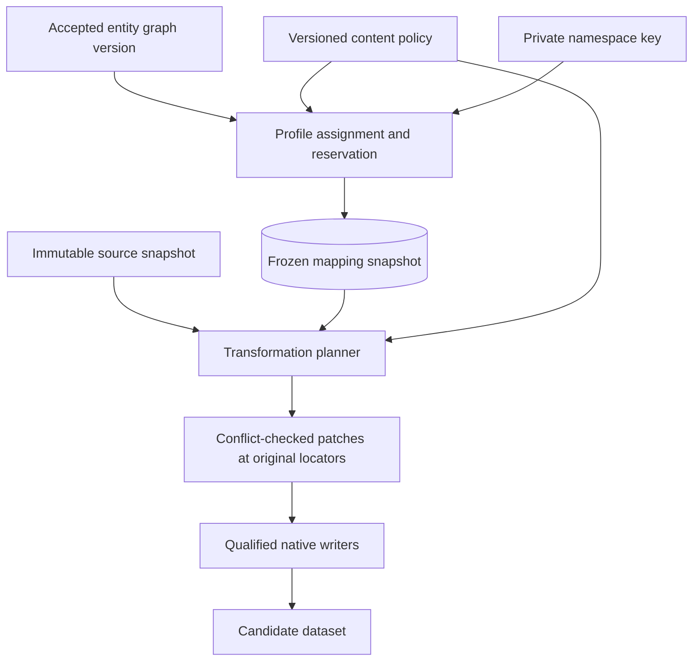
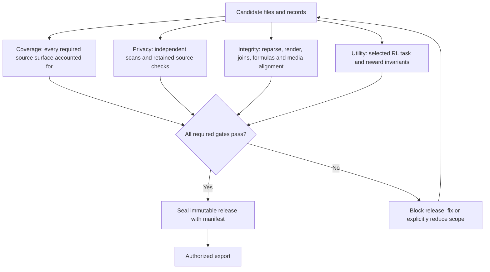
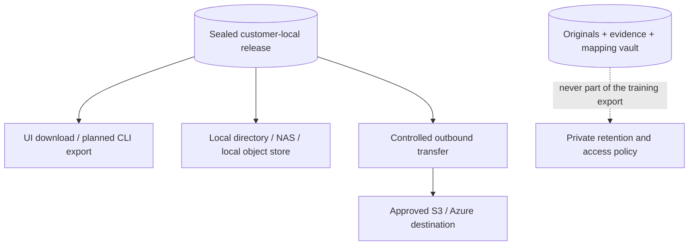

# Deterministic transformation and verified output

**Proposed architecture.** No transformation or release implementation is implied.
[Platform overview](overview.md).

## From accepted identity to repeatable replacement

| Stage | Deterministic behavior |
| --- | --- |
| Namespace | Scope to customer, project and intended recipient; separate namespaces reduce unintended cross-dataset linkage |
| Assignment | Derive candidates using a secret-keyed function over namespace, canonical entity ID, attribute type and policy version |
| Collision control | Use approved value catalogs, stable reservation order and database uniqueness constraints; persist collision resolution, never rely on an uncoordinated random seed |
| Profile consistency | One entity gets a coherent profile: first/full/last name, aliases, email and related IDs; two distinct entities must not collide on attributes declared unique |
| Temporal relationships | Account entities and ownership intervals remain explicit; a reused mailbox is not treated as a permanent person identifier |
| Incremental imports | Reuse frozen assignments for existing entities; allocate new values without renaming existing identities; corrections create a new graph/mapping revision |
| Patch planning | Resolve overlaps, repeated mentions, grammatical forms, structured references and format constraints before writing; reject conflicting patches |
| Replay | Pin source, graph, mapping, policy, adapter and writer versions; reuse accepted model output and generated media rather than invoking models again |

Simple keyed name selection is insufficient: collisions, profile coherence,
locale/script, maximum lengths, case, possessives, email validity and relational
keys all constrain an assignment. Replacement strings are never executable code,
SQL, formulas or template instructions. Original content is never modified in place.

## Content policy

| Sensitive material | Intended action | Important boundary |
| --- | --- | --- |
| Person, organization and account identifiers | Consistent synthetic replacement | Preserve supported relationships; separate identity matching from allocation |
| Credentials and access-bearing links | Remove or replace with clearly inert values | Never create functional credentials or preserve live signed URLs |
| Dates, amounts and addresses | Policy-constrained transformation | Preserve required ordering, totals, units and task constraints; reject contradictory rules |
| Confidential facts or proprietary material | Explicit policy for replacement, removal or artifact exclusion | PII detection alone does not identify all confidential information |
| Ambiguous identity | Gather evidence, review the group, or exclude affected scope | Never guess merely to reduce the queue |
| Unsupported or unverifiable surface | Quarantine or explicit exclusion | No unprocessed original is silently copied into a sanitized release |

## Independent release gates

| Gate | Checks and evidence |
| --- | --- |
| Coverage | Compare source inventory, expected surfaces, observations, patches and outputs; verify nested attachments and declared exclusions |
| Privacy | Independent recognizers, known-source identifier/alias checks, seeded canaries, metadata inspection and sampled human audits; inspect residual unique facts and relationships separately |
| Native integrity | Reparse every output; render selected/full required surfaces; inspect PDF object content, Office hidden parts and caches; validate image pixels and audio intervals |
| Referential integrity | Compare graph edges, foreign keys, counts and ownership windows; propagate transformations to related environment files, prompts, answers and reward checks |
| Utility | Run qualified task fixtures and compare required invariants; a syntactically valid file can still break an RL task |
| Export authorization | Recheck permissions at release/download time; mappings, private source locators, original IDs and keys must not enter the export |

Validation must have a way to reject the writer's result independently; rerunning
only the same detector is insufficient evidence. Run source-sensitive checks inside
the private boundary. Logs and public manifests contain aggregate findings and
opaque references, not original snippets or sensitive source hashes.

## What customers receive

| Output channel | Contents | Conditions |
| --- | --- | --- |
| **Native artifact bundle** | Qualified PDF/DOCX/XLSX/PPTX/image/text derivatives with synthetic identifiers | Each adapter must pass its surface-specific fidelity and privacy gates; format preservation is not guaranteed universally |
| **Structured dataset** | JSONL/CSV/Parquet records, synthetic IDs, preserved relationships and declared schemas | Covers only included fields/surfaces; raw payloads cannot be attached as a convenience field |
| **Conversation/environment package** | Sanitized threads, attachments and environment seeds with consistent references | Related expected answers and reward checks must be transformed coherently |
| **Transcript dataset** | Sanitized text with non-identifying timing/speaker labels as permitted | Original audio excluded unless separately qualified |
| **Qualified media derivative** | Sanitized images or audio, with declared edits and scope | Media-specific identity and integrity checks must pass |
| **Release manifest** | Release ID, policy/version identifiers, output hashes, schema, aggregate coverage, exclusions and validation outcomes | No source-to-surrogate map, secrets, original paths or raw evidence |

Cloud upload requires a separate outbound transfer component and destination
permissions. Collectors are read-only; output never overwrites the source SaaS
account or bucket by default. Downloads are authorized and audited. Release
revocation prevents future access but cannot recall copies already downloaded.

## Completion and claims

A release is complete only for its declared source scope, policy and supported
surfaces. Exclusions must be visible before approval; they do not retroactively
turn a partial input collection into complete coverage. A clean scan is evidence,
not proof that no sensitive information remains.

Measure detection misses, incorrect merges, residual identifiers, broken joins,
layout defects, audio/transcript mismatches and utility regressions separately.
Keep workload throughput measurements separate from privacy evaluations.
