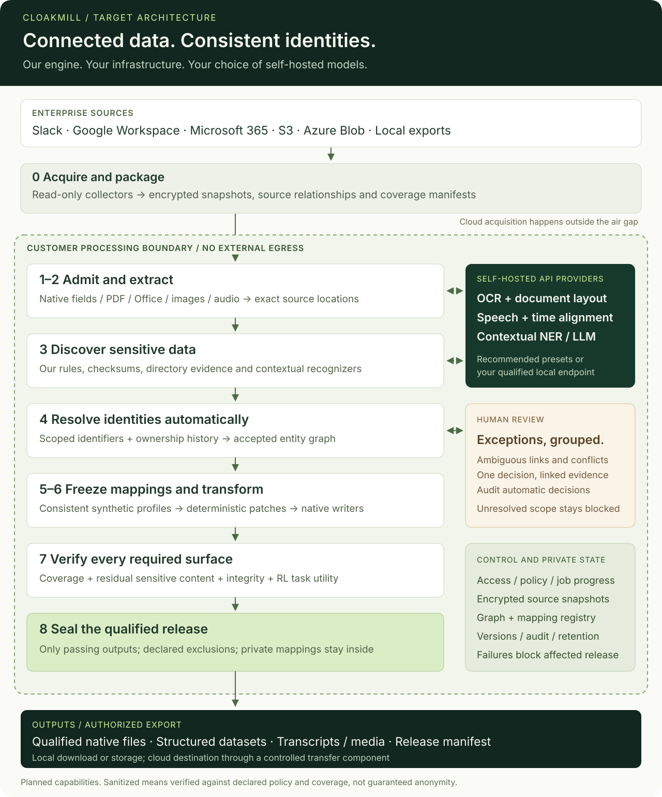
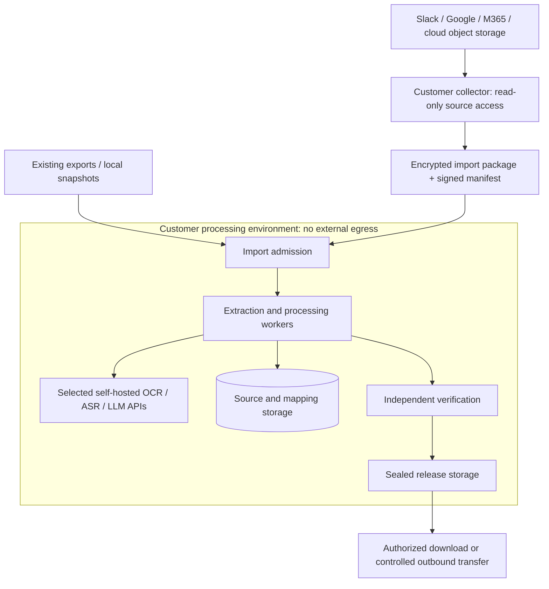
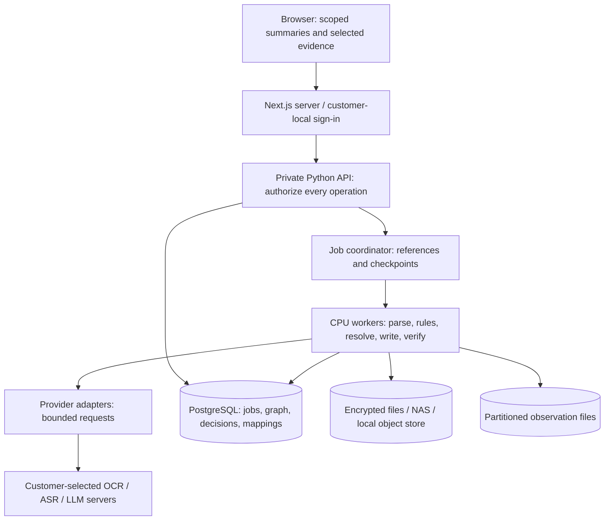

# CloakMill platform architecture

**Target design · 2026-10-31.** The Python package foundation and sample-backed
Next.js workspace exist. The connectors, processing engine, provider integrations
and release controls below are planned. Diagrams describe responsibilities, not
deployed services or proven coverage. See the [roadmap](../ROADMAP.md).

## The complete journey

CloakMill will own detection orchestration, recognizer contracts, evidence handling,
identity resolution, policy, synthetic mappings and verification. **No Presidio
dependency and no required hosted AI service.** Customers choose self-hosted OCR,
speech and language-model APIs through replaceable adapters. File codecs, model
runtimes and weights remain separately versioned dependencies; this is not a claim
of zero third-party software.

| Read next | What it explains |
| --- | --- |
| [Connectors and formats](connectors-and-formats.md) | Slack, Google Workspace, M365, S3, Azure Blob; acquisition, parsing, OCR, audio and native writing |
| [Detection and identity engine](discovery-and-identity.md) | How Presidio organizes recognition; our own engine, automatic resolution and exception review |
| [Self-hosted providers](model-providers.md) | Customer choice, recommended starting presets, local API contracts and bounded inference |
| [Transformation and release](outputs-and-verification.md) | Determinism, frozen mappings, output types, verification and release blockers |
| [Web security](web-security.md) | Browser, Next.js, private API, authorization and deployment boundaries |

## Layers and ownership

| Layer | Responsibility | Produces | Execution |
| --- | --- | --- | --- |
| 0. Acquire | Read selected scopes; capture available versions, relationships and access metadata | Immutable import package and coverage manifest | Networked customer collector, or existing offline exports |
| 1. Admit | Verify integrity, permissions, file types and resource limits; quarantine unsafe inputs | Private source snapshot with explicit exclusions | Offline Python workers |
| 2. Extract | Read native fields; route image regions to OCR and audio to transcription; preserve locators | Parts, text, coordinates, timestamps and coverage ledger | Isolated adapters and self-hosted APIs |
| 3. Detect | Schema, pattern, checksum, directory and contextual recognizers; optional model proposals | Typed observations with exact supporting evidence | CloakMill-owned Python engine |
| 4. Resolve | Link observations using stable anchors and ownership periods; surface conflicts | Versioned accepted entity graph and grouped exceptions | CloakMill-owned engine; targeted review |
| 5. Assign | Select policy actions; allocate consistent profiles and relational identifiers | Private frozen mapping snapshot and patch plan | Deterministic core plus transactional registry |
| 6. Write | Apply approved changes to supported native surfaces; rebuild derived artifacts | Candidate files, structured records and media | Format-specific workers |
| 7. Verify | Check residual sensitive content, coverage, structure, relationships and task utility | Findings and pass/block decisions | Separate validation workers |
| 8. Release | Seal only outputs whose required gates pass; enforce export permissions | Versioned dataset and non-sensitive manifest | Customer-local release service |

The control plane spans every layer: scope, policy, provider configuration,
authorization, jobs, cancellation, retention, audit events and release history.
Customer data belongs in the private data plane, not job names or logs.

## Network boundary

- A fully air-gapped installation imports packages through the customer's approved
  transfer process. It does not connect directly to Slack or cloud storage.
- Self-hosted APIs run inside that same boundary. HTTP API compatibility does not
  imply sending data to OpenAI, Anthropic, Google or another hosted model service.
- A customer-local object store can be read inside the boundary. Public S3/Azure
  endpoints require the collector boundary above. An S3-compatible store is not
  automatically compatible with every AWS feature.
- Source credentials remain at the collector. Model credentials remain server-side.
  A connected deployment is a different network configuration, never an automatic
  fallback when an offline provider fails.

## Application and runtime topology

Start with a modular Python application and bounded workers, not a mandatory
microservice fleet. Keep shared contracts in `src/cloakmill/domain/`; orchestration
in `pipeline/`; adapters in `connectors/` and `formats/`; processing in `detection/`,
`identity/`, `transforms/` and `validation/`. PostgreSQL holds indexed metadata and
decisions; encrypted artifacts and partitioned Parquet/Arrow hold large payloads.
These are target stack choices, not new runtime dependencies added by this design.

## Where determinism begins and ends

| Operation | Contract |
| --- | --- |
| Native parsing, rules, normalization and checksum checks | Repeatable with fixed bytes, adapter/rule versions and configuration; normalization retains a map back to original positions |
| OCR, speech recognition, NER and LLM inference | Treat results as observations that may vary; retain provider/model/configuration versions and accepted result snapshots |
| Identity decisions | Persist versioned evidence and policy decisions, including automatic decisions; freeze the accepted graph for a release |
| Profile assignment | Scope by customer/project/recipient namespace; reserve assignments transactionally; preserve existing mappings on incremental runs |
| Transformation replay | Same source snapshot, accepted graph, mapping, policy and writer version must produce equivalent normalized content and relationships |
| Byte-identical artifacts | A separate per-format promise: requires canonical ZIP ordering, metadata, timestamps and codec behavior; do not infer it from stable names |

Setting an LLM temperature to zero is not a reproducibility guarantee. Replays use
frozen accepted results rather than fresh inference. Provider changes create a new
analysis revision; they cannot silently alter a sealed release.

## Scale and operational behavior

| Concern | Design response |
| --- | --- |
| Millions of repeated mentions | Indexed candidate retrieval and grouped identity decisions; bounded partitions instead of an in-memory corpus or all-pairs comparison |
| Many unresolved groups | Prioritize by risk and affected artifacts; request better evidence, apply reviewed group decisions, or exclude affected artifacts explicitly |
| Expensive inference | Native text first, OCR only required surfaces, rules before contextual inference; separate CPU/GPU queues with quotas and backpressure |
| Retries and worker failure | At-least-once execution with idempotent commits, immutable inputs, bounded retries and atomic checkpoints; no claim of exactly-once delivery |
| Partial results | Track every expected artifact/surface as processed, unavailable, failed or excluded; partial jobs cannot produce a complete release |
| Incremental imports | Reuse unchanged observations, reconsider affected links, preserve existing profiles and invalidate dependent outputs when mappings change |
| Sensitive operational data | Opaque job IDs; private scoped caches; encrypted temporary files; payload-free logs; retention and key-rotation procedures |
| Air-gap readiness | Bundle pinned software, weights, tokenizers, language packs and licenses; disable downloads/telemetry; test with external networking denied |

## Meaning of sanitized output

The default identity action is **consistent synthetic replacement**. Policy can
also remove a sensitive span, substitute an inert credential, or exclude a whole
artifact when safe transformation is unavailable. Original identities and mapping
keys never belong in a training-data release.

Passing configured checks establishes evidence for a stated scope, not guaranteed
absence of PII or anonymity. Rare facts, relationship graphs and biometric voice
can still identify people. The distinction between pseudonymization and stronger
de-identification is also discussed in [NIST SP 800-188](https://csrc.nist.gov/pubs/sp/800/188/final).
