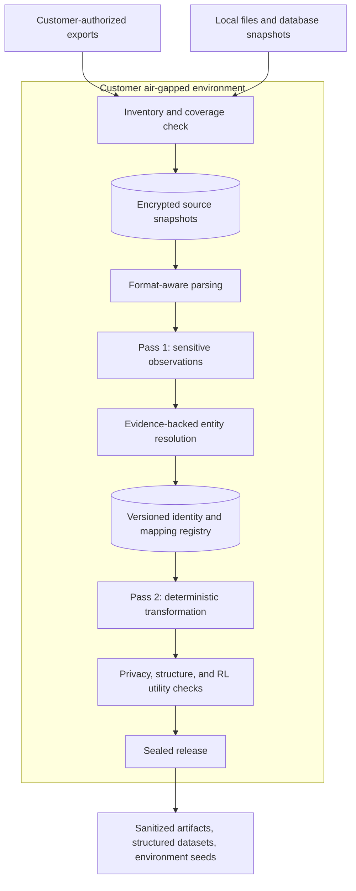
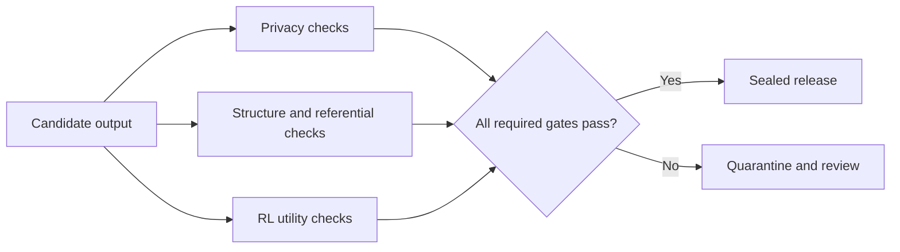

# Architecture direction

Status: proposed platform architecture. The current repository contains the package foundation and a sample-backed Next.js frontend, not this processing implementation. See the [roadmap](../ROADMAP.md).

## Product boundary

CloakMill is being designed as an offline pseudonymization platform for enterprise-derived RL datasets. It replaces identities consistently while checking that relationships, artifacts, and intended tasks remain useful.

Replacing direct identifiers does not guarantee anonymity. Rare facts, business information, long-term histories, and relationship graphs require separate privacy evaluation. See [NIST SP 800-188](https://csrc.nist.gov/pubs/sp/800/188/final).

## Data flow

Live SaaS export utilities, if introduced, run outside the air gap. The offline product imports their packages and reports available coverage. It cannot recover history or comments absent from the source export.

## Identity and determinism

- Represent people, accounts, organizations, projects, and business objects separately.
- Resolve mentions to stable canonical entities using source identifiers, directory evidence, contextual links, and ownership periods.
- Preserve evidence and distinguish observations from approved identity decisions.
- Do not merge people on a shared first name, reused email address, or a chain of weak matches.
- Use a namespace scoped to customer, project, and recipient. Freeze mapping snapshots per release; preserve existing assignments for incremental imports within a namespace.
- Derive synthetic profile candidates using secret keyed derivation over the namespace, entity ID, and attribute type. Reserve valid assignments transactionally to handle collisions and concurrent workers.
- Use one approved synthetic profile per entity so first names, full names, account identifiers, and email addresses remain aligned.

The repeatability contract is: identical source artifacts, accepted entity graph, mapping snapshot, policies, and software versions produce identical outputs. Fresh model inference is outside this guarantee until its accepted decisions are frozen.

## Shared representation and native fidelity

Store an artifact identifier, source version, access scope, parts, observations, original locators, entity links, and proposed patches. Locators retain original byte/text offsets, XML parts, table coordinates, or image bounding boxes as appropriate. Matching normalization must not invalidate original-source positions.

Document understanding and native rewriting are different adapters. [Docling](https://docling-project.github.io/docling/usage/supported_formats/) is a candidate extraction layer, not an assumed native Office round-trip writer. Its [offline configuration](https://docling-project.github.io/docling/faq/#how-do-i-run-completely-offline) requires locally available model artifacts.

Surface coverage must include visible and hidden content: Office comments and caches, PDF attachments and revisions, image metadata and QR codes, email alternatives and quoted replies, database relationships, and code paths and fixtures. Unsupported or encrypted content is quarantined rather than silently copied into an output advertised as processed.

## Models and sensitive content

Rules, schemas, directory lookups, and local NER are the baseline. A local LLM can propose bounded observations using nearby context and a capped list of candidate entities. It cannot assign synthetic identities, rewrite whole documents, execute tools, or call external services. Validate exact evidence spans and candidate references, persist accepted decisions, and abstain when evidence is insufficient.

Working credentials become inert test values. Sensitive facts and proprietary code require explicit content policies. Timeline and numeric transformations must preserve the constraints of their intended RL task or the artifact must be excluded from that release.

## Release gates

Independent validation should inspect output text, rendered surfaces, metadata, relationships, and task behavior. A detector's own confidence is not a release decision. Zero detected leaks is not proof of zero actual leaks.

Transform related environments, prompts, expected answers, and reward checks consistently. Split training/evaluation by underlying organizations and entities before replacing their identifiers.

## Storage and operations

Start with PostgreSQL for the identity registry, decisions, and job metadata; encrypted files/NAS for artifacts; and Parquet/Arrow for large intermediate observations. Do not put the entire corpus in PostgreSQL or RAM. Add infrastructure only when measured workloads require it.

Jobs exchange opaque references. Sensitive text must not enter logs, error messages, workflow histories, release reports, or public content hashes. Mappings and keys remain private and are excluded from the training dataset. Track entity-to-artifact dependencies for corrections, incremental processing, and release revocation.

Offline bundles must include dependencies, model weights, language assets, licenses, and an inventory, with signed update and recovery procedures. Development CI uses the network; that does not establish offline product readiness.
