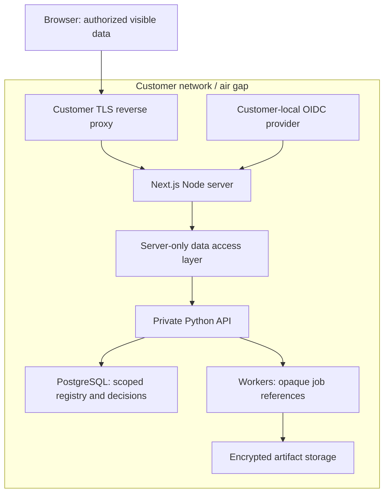

# Web application security direction

Status: target architecture and acceptance criteria. Step 2A is a fictional-data
foundation, not an authenticated enterprise deployment or a security certification.

Only the web origin is exposed to reviewers. Private network routing and service
authentication protect the Python API; an undisclosed URL does not. Browser users
can inspect or copy all data delivered to them, including RSC payloads, prefetches,
HTML and JavaScript. Server-only execution does not remove that fact.

| Boundary | Required control | Proof before private-data use |
| --- | --- | --- |
| Browser to web | Customer-local OIDC, MFA policy, revocable server sessions, Secure/HttpOnly/SameSite cookies, session rotation and expiry | Login/logout/expiry tests, revoked session rejection, no browser token storage |
| Every resource access | Server-derived tenant, project and role; deny by default; authenticate and authorize each Action, Route Handler and DAL operation | Cross-user/project/tenant read and mutation attempts fail, including direct HTTP calls |
| Web to Python | Private ingress, authenticated service connection, verified actor context; Python rechecks permissions | Direct unauthenticated API calls and forged actor/tenant metadata fail |
| Read responses | Minimal allowlisted DTOs; no credentials, private paths, mapping vault contents or unnecessary raw records | Check HTML, RSC, JSON, errors, JS bundles and prefetch responses with seeded canaries |
| Mutations | Input schema and size limits, resource permissions, CSRF/origin controls, idempotency and revision preconditions | Malformed/oversized/replayed/cross-origin/stale requests fail safely |
| Caching | Private workspace responses use no-store; no shared cache for identity evidence or mappings; disable sensitive speculative prefetch | Separate-session navigation and cache tests show no cross-user or stale-privilege disclosure |
| Rendering | Strict production CSP with request nonces, no production unsafe-eval, no arbitrary HTML; frame/object restrictions | Browser CSP checks, escaped input, no unexpected executable script or external fetch |
| Ingestion | Streaming to quarantine, size/expansion limits, malware/format checks, isolated parsers, no arbitrary upstream URLs | Archive bombs, path traversal, unsupported formats and SSRF fixtures rejected |
| Exports | Permission checked at download, immutable release snapshot, no mappings or keys, explicit audit event | Revoked access rejected; export manifest and payload invariant checks |
| Deployment | TLS, trusted forwarded headers, ingress/body/rate/time limits, least-privilege non-root services, customer-managed keys | Deployment tests, restore drills, key rotation and network-disabled runtime checks |
| Operations | Redacted logs, opaque IDs, access audit trail with no raw payloads, retention and revocation | Log canary checks and audit/retention tests |
| Supply chain | Exact versions and lockfile, dependency/security updates, SBOM and licenses, reviewed offline bundles | CI audit, package provenance checks, signed release inventory and upgrade test |

Step 2A implements only the boundaries it actually exercises: server-only sample
data access, opaque sample sessions, input validation, minimal DTOs, CSP/headers,
local assets and behavioral/browser tests. Sample session separation is not SSO,
RBAC or tenant isolation for real customers.

## Next.js choices

Use the latest verified stable patch, not canary dependencies. As checked on
2026-10-30 this is Next.js 16.4.3 and React 19.3.1. Next.js has announced seven
medium-severity fixes for 2026-11-03; impact/affected versions have not yet been
published in the advance notice. Review that release before production deployment.

Use App Router and Server Components for reads; reserve Client Components for
interaction. Treat Server Actions as exposed POST endpoints. Do not use action IDs,
hidden buttons, layouts or Proxy alone as authorization. Use `server-only` modules
for DAL/credentials. Never place secrets or internal service addresses in
`NEXT_PUBLIC_*`, client props, error text or redirect targets.

The protected workspace uses dynamic rendering for nonce CSP. Cache Components,
Partial Prefetching and other caching optimizations require a separate decision
about data scope, nonce compatibility, revocation and retention. New framework
features are evaluated against these constraints rather than switched on in bulk.

Sources: [Next.js security](https://nextjs.org/docs/app/guides/data-security),
[self-hosting](https://nextjs.org/docs/app/guides/self-hosting),
[CSP](https://nextjs.org/docs/app/guides/content-security-policy),
[November security release notice](https://nextjs.org/blog/upcoming-nextjs-security-release-november-2026).
