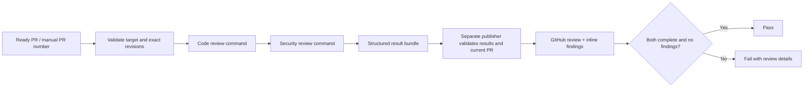

# Claude code and security review

[claude-review.yml](../../.github/workflows/claude-review.yml) runs two review
commands through the pinned official Claude Code Action. It uses Anthropic API
billing, independently of the separate hosted Claude Code Review service.

| Stage | Behavior | GitHub permission |
| --- | --- | --- |
| Code analysis | `/code-review high <base>...<head>`; verify correctness findings | Read only |
| Security analysis | `/security-review`; trace exploit paths and filter false positives | Read only |
| Result transfer | Extract schema-validated findings from the SDK result; retain bundle for one day | Artifact upload |
| Publish and gate | Validate both results and revisions; post a neutral GitHub review with inline findings | PR write |

## Setup and reruns

1. Add `ANTHROPIC_API_KEY` under [Settings → Secrets and variables → Actions → Repository secrets](https://github.com/deep-chokshi/cloakmill/settings/secrets/actions).
   Use a **secret**, not an Actions variable. The account needs API access and
   credit. Never paste the key into source, a PR, issue, or chat.
2. Review and merge the workflow setup PR when ready. No PR is merged by this
   automation. After the workflow reaches `main`, manual dispatch is available.
3. Select **Actions → Claude review → Run workflow**, choose `main`, and enter
   the target `pr_number` (`1` for the existing UI prototype PR).

Ready, same-repository PRs run automatically on opening, new commits, reopening,
or being marked ready. Drafts and forks are excluded. The official action checks
actor permissions and rejects bots by default. No `@claude` comment is needed.
To repeat a current-head run, use **Re-run all jobs**. A new commit starts a new
review automatically. Re-running an old event after the PR changes is rejected.

The analysis job is named **Analyze code and security**. The blocking result is
**Publish and gate code and security review**. Repository rules can require this
check; this change does not edit branch-protection settings.

## Review contract

The commands run at the exact head commit. The security command's `origin/HEAD`
is pinned to the PR base, including when the PR targets a branch other than
`main`. Controls come from the workflow revision, and product guidance comes
from the base revision. PR-authored project settings are not loaded; hooks are
disabled. No `--fix` or `--comment` flag is passed. Source inspection tools and
read-only git/PR commands are available; project scripts are not executed.

Both passes return a bounded JSON result using `--json-schema`. Findings require
a severity, confidence of at least 0.8, explanation, concrete evidence or exploit
scenario, recommendation, and an added-line source anchor. Security findings
must be medium impact or higher. Candidate findings are checked against source
and filtered before reporting. The prompt distinguishes the fictional Step 1 UI
from a production privacy engine.

Each pass invokes its review command through Claude's `Skill` tool inside the
agent loop, then returns structured findings. Starting the prompt directly with
`/code-review` can finish outside that loop without `structured_output`; that
behavior was observed in the first live run. The collector requires an actual
matching Skill call and a successful tool return, so a JSON completion claim
without running the requested command cannot pass.

The collector extracts only the SDK's `structured_output` from a successful
result. A plain assistant reply, budget error, permission denial, missing output,
or failed action is incomplete. Raw sessions and credentials are not uploaded.
Each pass is extracted immediately because the official action reuses its
execution-file path between invocations.

The publisher checks target identity, current base/head, schema, completion, full
changed-file inventory, and added-line anchors. It posts with `event: COMMENT`,
never approval or merge, and reads the review back to confirm publication.
Duplicate findings share an inline comment; publication is idempotent within
one run attempt. A base/head change requires a new review.

The review includes both pass statuses, reviewed SHAs, run link, limitations,
and one of `Review-Result: no-actionable-findings`, `findings`, or `incomplete`.
Only two complete passes without findings pass the gate. Findings require human
verification and a subsequent fix or documented false-positive decision; an
invalid or incomplete result cannot become a clean review. AI review can miss
defects and does not guarantee security. Python/package tests run independently.

## Cost, scope, and diagnosis

Each pass uses the `sonnet` alias, a 48-turn limit, and a USD 5 estimated API spend
limit. The analysis job times out after 35 minutes and publishing after five.
The two-pass estimate can exceed USD 10 because the client estimate is not an
exact billing cap; configure Anthropic account controls too. New runs cancel
superseded runs for the same PR. Canceled or timed-out reviews are incomplete.

This connected development service sends repository content to Anthropic. It
does not alter CloakMill's intended offline runtime. Only synthetic data belongs
in this repository. The workflow is for trusted contributors; a fork-review
path needs its own design. Do not replace the trigger with `pull_request_target`
and check out an untrusted head with secrets.

| Symptom | Diagnosis |
| --- | --- |
| Secret check fails | Add the exact repository Actions secret named above. |
| Anthropic authentication/billing failure | Check key access, workspace, credit, and account limits. |
| Analysis ran but gate fails | Read both statuses in the PR review; findings or incomplete results fail intentionally. |
| No structured result / permission denial | Inspect the corresponding command step. Do not infer a completed review from session success. |
| GitHub publication error | Check PR-write permission and organization Actions policies. |
| Changed revision error | Start a review for the new PR base/head. |
| Workflow absent from Actions menu | Manual dispatch needs the workflow on `main`. |
| Separate Claude app check remains queued | This workflow does not repair the hosted service's queue. |

References: [Anthropic GitHub Actions](https://code.claude.com/docs/en/github-actions),
[`/code-review`](https://code.claude.com/docs/en/code-review-local),
[security review](https://support.claude.com/en/articles/11932705-automated-security-reviews-in-claude-code),
[structured outputs](https://code.claude.com/docs/en/agent-sdk/structured-outputs),
and [official security-review guidance](https://github.com/anthropics/claude-code-security-review).
