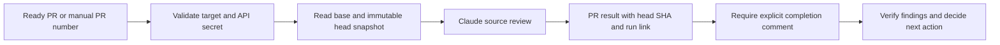

# Claude PR review

[claude-review.yml](../../.github/workflows/claude-review.yml) runs the official
[Claude Code Action](https://github.com/anthropics/claude-code-action), pinned to a
commit. It uses Anthropic API billing and the job-scoped `GITHUB_TOKEN`; it does
not depend on the separate hosted Claude review queue or its app-token exchange.

## Enable it

1. Open [repository Actions secrets](https://github.com/deep-chokshi/cloakmill/settings/secrets/actions).
2. Choose **New repository secret**. Set the name to `ANTHROPIC_API_KEY` and the
   value to your Anthropic API key. Use a **secret**, not an Actions variable.
   The Anthropic account needs API access and available credit. Never paste the
   key into a PR, issue, source file, or chat.
3. Review and merge the workflow setup PR when ready. Manual dispatch becomes
   available after the workflow reaches `main`. This does not merge the UI PR.
4. Open **Actions → Claude review → Run workflow**. Select `main`, enter `1` in
   `pr_number` to review the existing UI prototype PR, and run it once.

After activation, ready PRs from branches in this repository run automatically
when opened, updated, reopened, or marked ready. Drafts and forks are excluded;
the action also checks actor permissions and rejects bots by default. A manual
run validates that its target is an open, ready PR from this repository. No
`@claude` comment is required. Avoid sending duplicate requests to the separate
hosted integration while this workflow reviews the same change.

## What it does

The reviewer inspects source and posts one summary identifying the reviewed head,
concrete findings with file/line references, and review limits. Its prompt
distinguishes fictional Step 1 prototype behavior from production requirements.
It does not run project tests or fix code; the existing CI workflow checks code
independently. Findings require human verification. The workflow cannot push code
with its read-only contents token and does not approve or merge PRs.

Each run has a 20-minute timeout, a 24-turn limit, and a USD 5 estimated API spend
limit using the `sonnet` alias. The estimate is not an exact billing cap; set
appropriate controls in the Anthropic account too. New runs for the same PR
cancel superseded runs. Canceled, timed-out, or budget-limited reviews are
incomplete, even if some feedback was already posted.

Full model output is disabled. Hooks are disabled and model tools are limited to
reading source and PR inspection/comment commands; these controls do not remove
all prompt-injection risks. Same-repository review is intended for trusted
contributors. Fork contributions need a separately designed review path. Never
change this to `pull_request_target` with an untrusted head checkout.

This is a connected **development service**: repository content is sent to
Anthropic. It is separate from CloakMill's intended offline processing runtime.
Only synthetic data belongs in this repository.

## Read the result and diagnose failures

Find the run under **Actions → Claude review** and its linked PR comment. The
comment must name the current head SHA and contain `Review-Result: findings` or
`Review-Result: no-actionable-findings`. A successful job means an explicit result
was posted, and may still contain actionable findings. It is not an approval or
proof of correctness. No comment, an incomplete comment, or an old-head comment
is not a completed review of the current code.

| Symptom | Action |
| --- | --- |
| `Check API secret` fails | Add the repository Actions secret with the exact name above. |
| Anthropic authentication or billing fails | Check the key's API access, workspace, credit, and account limits. Rerun after correcting it. |
| Posting a comment is denied | Check repository/organization Actions policies allow the workflow's `pull-requests: write` permission. |
| Workflow is absent from the Actions menu | Merge the setup workflow to `main`; manual dispatch requires it on the default branch. |
| Job is skipped | Check draft/fork status and the triggering actor. |
| No explicit result or the head changed | Inspect the run failure, then rerun against the current head. Do not assume a clean review. |
| A separate Claude app check stays queued | Inspect this Actions run independently; this workflow does not repair the hosted review service. |

Dependency updates for pinned actions are proposed by the existing Dependabot
configuration. Review those updates before merging them.
