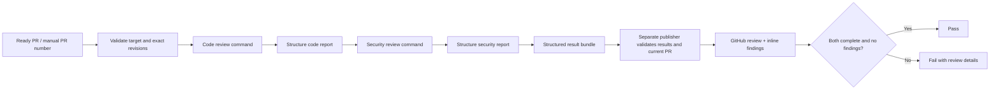

# Claude code and security review

[claude-review.yml](../../.github/workflows/claude-review.yml) runs two review
commands through the pinned official Claude Code Action. It uses Anthropic API
billing, independently of the separate hosted Claude Code Review service.

| Stage | Behavior | GitHub permission |
| --- | --- | --- |
| Code analysis | Run `/code-review high <base>...<head>` as the prompt; its reply is the findings report | Read only |
| Security analysis | Run `/security-review` as the prompt; its reply is the markdown vulnerability report | Read only |
| Structuring | A second, tool-restricted Claude stage transcribes each report into the JSON schema | Read only |
| Result transfer | Extract `structured_output`; retain the bundle for one day and diagnostics for seven | Artifact upload |
| Publish and gate | Validate both results and revisions; post a neutral GitHub review with inline findings | PR write |

## Setup and reruns

1. Add `ANTHROPIC_API_KEY` under [Settings → Secrets and variables → Actions → Repository secrets](https://github.com/deep-chokshi/cloakmill/settings/secrets/actions).
   Use a **secret**, not an Actions variable. The account needs API access and
   credit. Never paste the key into source, a PR, issue, or chat.
2. Review and merge the workflow setup PR when ready. No PR is merged by this
   automation. After the workflow reaches `main`, manual dispatch is available.
3. Select **Actions → Claude review → Run workflow**, choose `main`, and enter
   the target `pr_number` (`1` for the existing UI prototype PR).

Ready, same-repository PRs run automatically on opening, new commits, reopening,
or being marked ready. Drafts and forks are excluded. The official action checks
actor permissions and rejects bots by default. No `@claude` comment is needed.
To repeat a current-head run, use **Re-run all jobs**. A new commit starts a new
review automatically. Re-running an old event after the PR changes is rejected.

The analysis job is named **Analyze code and security**. The blocking result is
**Publish and gate code and security review**. Repository rules can require this
check; this change does not edit branch-protection settings.

## Review contract

The commands run at the exact head commit. The security command's `origin/HEAD`
is pinned to the PR base, including when the PR targets a branch other than
`main`. Controls come from the workflow revision, and product guidance comes
from the base revision. PR-authored project settings are not loaded; hooks are
disabled. No `--fix` or `--comment` flag is passed. Source inspection tools and
read-only git/PR commands are available; project scripts are not executed.

Each pass has two Claude stages. The review stage runs the bundled command
itself as the prompt, which is how the Claude Code docs run review skills in
CI: `/code-review` runs as a forked review and replies with its findings list,
and `/security-review` replies with its markdown report. A CI contract appended
to the system prompt tells the command to follow its own methodology completely,
including its sub-tasks, to stay report-only, where the trusted guidance file is,
and that the Step 1 UI prototype is fictional. Neither reply carries
`structured_output`, so a structuring stage with only Read, Glob, Grep, and
`git diff` transcribes the report into the bounded JSON schema with
`--json-schema`, anchors each finding to an added line, and marks the pass
incomplete when the report is an error, a refusal, or a generic message.

Findings require a severity, confidence of at least 0.8, explanation, concrete
evidence or exploit scenario, recommendation, and an added-line source anchor.
Security findings must be medium impact or higher. The bundled commands verify
candidates and filter false positives before the report exists; the structuring
stage transcribes and must not add findings.

The review-stage collector accepts a report only from a successful result with
at least one completed turn, because an authentication or startup failure returns
a zero-turn success whose text is the error. The structuring-stage collector
extracts only the SDK's `structured_output`. A plain assistant reply, budget
error, permission denial, missing output, skipped stage, or failed action is
incomplete. Raw sessions and credentials are not uploaded. Each stage is
collected immediately because the official action reuses its execution-file path
between invocations.

The publisher checks target identity, current base/head, schema, completion, full
changed-file inventory, and added-line anchors. It posts with `event: COMMENT`,
never approval or merge, and reads the review back to confirm publication.
Duplicate findings share an inline comment; publication is idempotent within
one run attempt. A base/head change requires a new review.

The review includes both pass statuses, reviewed SHAs, run link, limitations,
and one of `Review-Result: no-actionable-findings`, `findings`, or `incomplete`.
Only two complete passes without findings pass the gate. Findings require human
verification and a subsequent fix or documented false-positive decision; an
invalid or incomplete result cannot become a clean review. AI review can miss
defects and does not guarantee security. Python/package tests run independently.

## Diagnostics

Every Claude stage writes a diagnostics file: outcome and reason, result
subtype, turns, cost, duration, tool calls by name and by subagent, permission
denials, a trace of tool names and their targets, and, for review stages, the
command's report text. Tool results, file contents, and credentials are never
written. The analysis job uploads them as `claude-review-diagnostics-<run id>`
for seven days and prints one line per stage in the job summary; the published
review repeats the numeric statistics per pass. When a pass is incomplete, read
that artifact first: the stage file names the reason.

## Cost, scope, and diagnosis

Every stage uses the `CLOAKMILL_REVIEW_MODEL` alias set in the workflow
(`sonnet` by default; `opus` is the higher-quality, higher-cost option). Review
stages have a 64-turn limit and a USD 6 estimated spend limit; structuring stages
have 16 turns and USD 1.5. The analysis job times out after 45 minutes and
publishing after five. The four-stage estimate can exceed USD 15 because the
client estimate is not an exact billing cap; configure Anthropic account controls
too. New runs cancel superseded runs for the same PR. Canceled or timed-out
reviews are incomplete.

This connected development service sends repository content to Anthropic. It
does not alter CloakMill's intended offline runtime. Only synthetic data belongs
in this repository. The workflow is for trusted contributors; a fork-review
path needs its own design. Do not replace the trigger with `pull_request_target`
and check out an untrusted head with secrets.

| Symptom | Diagnosis |
| --- | --- |
| Secret check fails | Add the exact repository Actions secret named above. |
| Anthropic authentication/billing failure | Check key access, workspace, credit, and account limits. |
| Analysis ran but gate fails | Read both statuses in the PR review; findings or incomplete results fail intentionally. |
| Review or structuring stage incomplete | Download `claude-review-diagnostics-<run id>`; the stage file names the reason and holds the report text and tool trace. Do not infer a completed review from session success. |
| GitHub publication error | Check PR-write permission and organization Actions policies. |
| Changed revision error | Start a review for the new PR base/head. |
| Workflow absent from Actions menu | Manual dispatch needs the workflow on `main`. |
| Separate Claude app check remains queued | This workflow does not repair the hosted service's queue. |

References: [Anthropic GitHub Actions](https://code.claude.com/docs/en/github-actions),
[`/code-review`](https://code.claude.com/docs/en/code-review-local),
[security review](https://support.claude.com/en/articles/11932705-automated-security-reviews-in-claude-code),
[structured outputs](https://code.claude.com/docs/en/agent-sdk/structured-outputs),
and [official security-review guidance](https://github.com/anthropics/claude-code-security-review).
