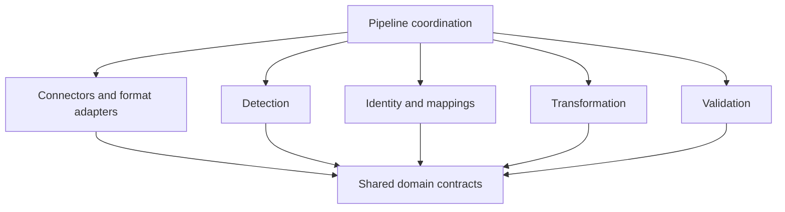

# Project structure

One Python distribution keeps shared identity and transformation contracts together while the product is young. The subpackages are boundaries, not implemented services.

```text
cloakmill/
├── src/cloakmill/
│   ├── domain/          Shared records, locators, evidence, policy contracts
│   ├── connectors/      Offline source/export readers
│   ├── formats/         Parsers and native-format writers
│   ├── detection/       Rules and local-model observations
│   ├── identity/        Resolution, aliases, mapping snapshots, synthetic profiles
│   ├── transforms/      Transformation planning and deterministic patch application
│   ├── validation/      Privacy, structural, and task-utility checks
│   └── pipeline/        Job coordination and release manifests
├── tests/               Synthetic behavioral tests as features land
├── examples/synthetic/  Redistributable illustrative examples
├── docs/
│   ├── assets/          Repository-local product visuals
│   ├── architecture/    System design and architectural boundaries
│   ├── development/     Contributor setup and repository map
│   └── superpowers/     Dated specifications and execution plans
├── .github/             CI, contribution templates, dependency update configuration
├── pyproject.toml       Package, build, lint, and test configuration
└── uv.lock              Committed development dependency resolution
```

## Dependency direction



- `domain` must not import adapters, model runtimes, or pipeline orchestration.
- Detection produces evidence; it does not assign synthetic values.
- Identity resolution owns canonical links and mapping snapshots.
- Format writers apply approved patches; they do not invent identities.
- Validation must be able to reject a candidate output independently of its writer.
- Pipeline coordination passes opaque references rather than copying sensitive text into job histories.

Introduce storage adapters when the first persistent registry needs them. Add `apps/review-ui/` only when a local review frontend is designed. Avoid empty service scaffolds, unneeded databases, and runtime dependencies ahead of their first consumer.
