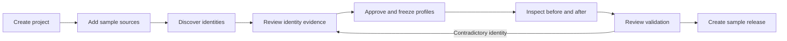

# Step 1: workspace experience

The user selected a **light workspace with a dark sidebar**, based on CloakMill's forest-green and lime branding. The [clickable prototype](../../prototypes/workspace/README.md) makes this experience reviewable using fictional data. It is not the production application.

## Primary journey

## Screen contracts

| Screen | User decision | Essential states |
| --- | --- | --- |
| Overview | What needs attention next? | Populated sample, empty project, release readiness |
| Sources | What is included and what is unsupported? | Sample inventory, explicit exclusion, no silent coverage |
| Discovery | Which observations need inspection? | Idle, labeled sample progress, authored observations |
| Identity review | Which mentions belong together? | Ambiguous person, shared account, evidence, confirmed review |
| Replacement profiles | Are replacement attributes coherent? | Profile choices, namespace, blocked freeze, frozen revision |
| Preview | What changed and what stayed connected? | Original/replacement panes, record navigation, unresolved mention |
| Validation | Can this revision become a sample release? | Not ready, illustrative pass, contradictory-identity failure, correction route |
| Releases | What can leave the workspace? | Empty state, blocked creation, fictional bundle, immutable older snapshot |

## Interaction principles

- The overview opens with populated fictional content so a reviewer can understand the product immediately. A new project exposes the true empty journey.
- Put source evidence next to identity choices. A recommendation is not a decision until explicitly confirmed.
- Separate people from shared accounts. A first name or forwarded signature must not imply a merge.
- Exclusions require explicit decisions and appear in coverage metadata.
- Changes to identities, profiles, or scope invalidate the current mapping approval and validation.
- Keep unresolved source mentions visible in a working preview; prevent them from entering an approved sample release.
- Show a recovery route when a decision fails the authored validation scenario.
- Keep private mapping tables out of the fictional downloadable bundle.
- Use explicit labels rather than color alone; support keyboard dialogs, visible focus, mobile navigation, and reduced motion.
- Keep a persistent prototype disclosure. No real-file input, telemetry, remote model, or external font request is part of this artifact.

## Review checklist

- Is the next action clear without reading a guide?
- Can a reviewer explain why the two Mayas remain separate?
- Can a reviewer distinguish a mailbox from a person?
- Does source coverage communicate exclusions honestly?
- Can someone trace a replacement from its record back to the original identity evidence?
- Is it clear why a release is blocked and how to resolve it?
- Are approval invalidation and historical sample snapshots understandable?
- Are the screens comfortable on both desktop and a narrow mobile viewport?

## Subsequent implementation

Step 2 turns the reviewed visual system and interactions into the production frontend foundation. Step 3 introduces the persistent API and access/storage controls. Real source ingestion begins later. Prototype code is a design reference; it does not establish a production security boundary or a general-purpose transformation engine.
