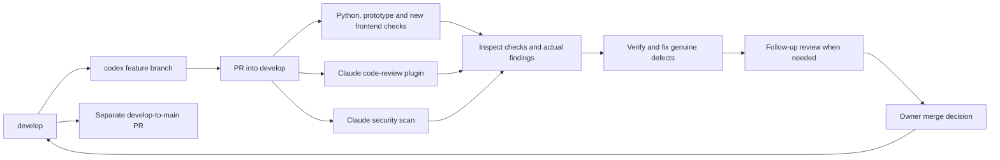
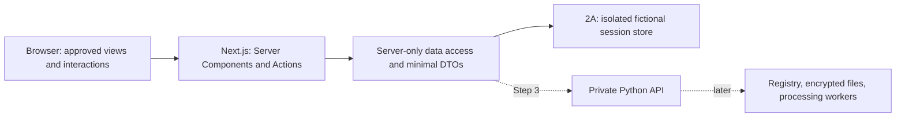

# Step 2: application frontend foundation

Date: 2026-10-30. Status: Step 2A implemented and verified locally with the owner's Next.js and security requirements. Hosted CI and PR review are pending.

## Outcome

Turn the approved Step 1 visual system into a maintainable application under
`apps/review-ui/`. Preserve the forest sidebar, warm light workspace, lime actions,
local typography, and evidence-first interactions. The first implementation slice
delivers working project navigation and source inventory with an explicitly
fictional, session-isolated server memory adapter.

The application foundation is intended to become the production frontend. This
milestone does not make it ready to accept enterprise data. Step 3 introduces the
persistent API and access/storage controls; real source ingestion follows.

## Current baseline

Inspected local and fetched remote state on 2026-10-30:

- `main` and `develop` both point to `95dafbaa7edf0061cffae36e3c92cf0574581dbb`.
- The Step 1 prototype and Claude workflow changes have merged.
- Latest CI on both branches and the main-branch protection check passed.
- The prototype has twelve Node behavioral tests. The Python package remains a
  foundation with no implemented processing pipeline.
- The agreed implementation sequence is recorded in `docs/product/ux-workflow.md`:
  frontend foundation, persistent API, then real ingestion.

### Development and review flow



Follow the current workflows; do not reintroduce the superseded structured-review
implementation from the earlier setup work.

| Current workflow | Behavior relevant to feature work |
| --- | --- |
| `ci.yml` | Python 3.12/3.13 lint/build/import checks and prototype Node tests; add a separate frontend job when that app exists. |
| `claude-code-review.yml` | Official marketplace plugin, foreground execution, inline-comment tool permission, job token for posting. Its documented once-per-PR/skip behavior means later pushes need an explicit follow-up when warranted. |
| `claude-security-review.yml` | Official security action, configured model, every-commit scans, a maintained findings comment, and a completion guard. Findings themselves are advisory. |
| `claude.yml` | Authorized `@claude` follow-ups; can write code. Restricts who can trigger it and refuses fork PRs and outsider-authored threads. |
| `protect-main.yml` | Required check allows only this repository's `develop` PRs into `main`; its privileged PR check does not execute PR code. |

The active main ruleset requires `Main only accepts develop`. It does not currently
require the Python, frontend, or Claude checks. Inspect these checks before proposing
a merge; do not describe them as enforced merge gates. No branch-rule change is part
of this milestone. A green review job is not sufficient evidence of a posted code
review: PR #7 has successful review jobs but no posted review/comment at inspection.

## Architecture choice

The owner selected Next.js in place of the initial Vite proposal. Use **Next.js
16.4.3 App Router, React 19.3.1 and TypeScript**, verified against the npm stable
dist-tags on 2026-10-30. Pin exact dependencies and commit the lockfile. Recheck
security advisories before deployment and after updates; latest is not a guarantee
that a version has no vulnerabilities. Next.js has announced a security update for
2026-11-03; review and apply the appropriate patched release when available.



The browser can inspect its requests to Next.js, action arguments, returned HTML,
RSC payloads, and JavaScript. Internal service URLs, credentials and Python calls
stay server-side only if we never serialize them. Server Actions are callable HTTP
endpoints, not hidden authorization mechanisms.

Use Server Components for page reads and small Client Components for dialogs and
navigation. Use Server Actions with validated arguments for sample mutations;
useActionState provides pending/error feedback. A server-only DAL mediates every
store access. In Step 3 it will authenticate sessions and enforce resource access
before calling the private Python service, which must also authorize each request.

Use App Router layouts, loading/error/not-found boundaries, typed routes, local
fonts, CSS tokens and component styles. Use Turbopack for development. Protected
workspace rendering is dynamic with per-request CSP nonces. Cache Components and
Partial Prefetching are deferred for these routes: nonce-based CSP requires dynamic
rendering, and sensitive data must not enter a shared cache or speculative prefetch.
This is a documented security/performance choice, not use of an outdated router.

Use a self-hosted Node runtime behind the customer's TLS reverse proxy; static
export cannot provide this server boundary. No Vercel account or cloud runtime
service is required. Bundle assets locally and disable Next telemetry. Packaging
an air-gapped installation, SSO, TLS, rate limits and distributed operation are later
milestones with their own tests.

Use Node behavioral tests for the pure store/validation contracts and Playwright
for end-to-end verification against the production build. Run TypeScript and ESLint
in CI. No production data, credentials or enterprise authentication are introduced
by this sample-only milestone.

References: [Next.js data security](https://nextjs.org/docs/app/guides/data-security),
[self-hosting](https://nextjs.org/docs/app/guides/self-hosting),
[CSP](https://nextjs.org/docs/app/guides/content-security-policy),
[16.4 release](https://nextjs.org/blog/next-16-4), and
[November security notice](https://nextjs.org/blog/upcoming-nextjs-security-release-november-2026).

## Incremental delivery

Each increment includes its own behavior tests and browser verification.

| Increment | User-visible result | Evidence needed |
| --- | --- | --- |
| **2A — first implementation** | Responsive workspace, URL navigation, create/select sample projects, overview, sample source list and details. | Keyboard/dialog behavior, deep links, invalid project handling, source states, stale-request cancellation, built-app network check. |
| 2B — review journey | Discovery, identity review, replacement profiles, preview, validation, and sample releases in typed feature components. | Full correction journey, approval invalidation, immutable sample releases, no private mappings in the sample download. |
| 2C — integration preparation | Consistent request/error/retry handling and a documented adapter contract suitable for the persistent API. | Adapter contract tests and loading/failure/retry checks across the completed journey. |

This design fully scopes 2A. The later increments need their own focused designs;
they are not permission to implement ingestion or a processing engine now.

## 2A: screens and interactions

| Surface | Behavior |
| --- | --- |
| Workspace entry | Start with no project. Offer `Create sample project` and `Explore sample workspace`. A persistent notice says data is fictional and samples expire after two hours or a server restart. |
| Create project | Dialog with a name field. Trim leading/trailing whitespace; require 1–120 Unicode characters after trimming. Render as text. Show the validation error beside the field, retain the entered value, and keep the dialog open on failure. |
| Project switcher | Select an existing session-scoped sample project or create another. Use generated opaque IDs in routes; project names never become URL components. |
| Overview | Show current project name, actual sample-source counts, and the next available action. Zero sources produces an actionable empty state. |
| Sources | `Load sample sources` installs the authored source inventory once per project. It is idempotent. Display format, record count where known, and declared sample coverage. |
| Source details | Inspect fictional metadata and the supported/unsupported surfaces declared for that sample. An encrypted sample is visibly unavailable; a filename extension does not establish support. |
| Remaining six screens | Preserve the approved navigation order. Routes show an honest not-yet-connected state and return path. No simulated scan/approval/release actions are available in 2A. |
| Unknown project or route | Explain that the project is unavailable in this browser session and provide a workspace link. Never silently substitute another project. |

All real-file ingestion affordances remain unavailable and explain which milestone
will enable them. This slice has no file-input reader, drag/drop processing, local
folder enumeration, uploads, real connection credentials, or persistent database.

Use App Router filesystem routes with a root deployment base. Routes are `/`,
`/projects/:projectId/overview`, `/projects/:projectId/sources`, and the six named
workflow screens under the same project path. Source details can use a nested
`/projects/:projectId/sources/:sourceId` route. Browser-test direct links against the Next.js production server. Project identity is in the URL; dialog-open state and unsaved field text stay local to the relevant component.

## Components and file boundaries

```text
apps/review-ui/
  package.json, package-lock.json  Frontend dependencies and reproducible installs
  next.config.ts                  Standalone build, typed routes and action limits
  src/
    app/                          App Router layouts, pages, actions, safe errors
    components/                   Shell, dialog, status badge, empty/error states
    app/projects/                 Overview, source inventory/detail and planned routes
    server/                       Server-only DAL and session cookie boundary
    lib/                          DTOs, validation, bounded sample store and CSP
    app/globals.css               Brand tokens, base styles and component styles
    assets/                       Local fonts, notices and icons
  tests/                          Cross-feature behavior and adapter tests
  e2e/                            Browser journeys against the built application
```

Create files when an implemented responsibility needs them. Do not add placeholder
modules for future Python services or copy the prototype's entire model into the
application. Keep the prototype independently runnable as a visual reference.

The DAL exposes only the operations used by 2A: list/create projects, get a project
summary, list/get sample sources, and load the sample inventory. Store lookups
require an opaque session token read from an HttpOnly, SameSite=Strict cookie.
This token isolates fictional workspaces; it is not enterprise user authentication.
Use a bounded store (128 sessions, 20 projects per session), two-hour expiry, and
cryptographically random session and project IDs. Expired sessions fail safely.
The source loader is idempotent; project creation uses an idempotency key per form.
Components receive minimal DTOs, never session tokens, private source paths or full
store records. Browser persistence contains only the opaque session cookie, not
project data or source records. Secure cookies are mandatory under TLS; loopback
HTTP development is an explicit local-only exception.

## Errors, accessibility and runtime boundary

- Loading, empty, unavailable, failed, and retrying states are distinct. A failed
  request must not appear as an empty successful source list.
- App Router owns navigation concurrency. A delayed response for project A must
  never replace project B after navigation; include a browser regression test.
- Preserve component identity and focused controls during background updates.
  Route changes focus the page heading; local actions do not reset focus to the
  top of the page. Dialogs contain keyboard focus, close on Escape, and restore
  focus to their opener. Announcements use a persistent live region.
- At narrow widths, navigation has explicit open/close controls, Escape dismissal,
  and an inert background while open. Tables scroll inside their containers.
- Use visible focus, labels rather than color alone, reduced motion, and readable
  contrast. Reuse the accepted visual treatment rather than redesigning it.
- Bundle all assets. The built Step 2 app makes no external runtime requests,
  performs no telemetry, and stores no dataset/project state in browser persistence.
  Development dependency installation and CI may use the network.
- Error UI and logs contain controlled messages, not serialized input records,
  names, file contents, or stack traces. Do not claim authentication, encryption,
  privacy validation, or an air-gapped installer exists in this milestone.

## Acceptance checks for 2A

| Check | Required observation |
| --- | --- |
| Empty start and project creation | Create two projects, switch between them, reject blank/oversized names, preserve valid Unicode, and render markup-like names as text. |
| Project/source isolation | Loading samples in A does not populate B. Repeating the load does not duplicate records. Unknown IDs produce the correct unavailable state. |
| Cancellation | Resolve a delayed A response after switching to B; B remains visible. Persistent API failure/retry adapters belong to 2C. |
| Routing | Back/forward navigation and direct URLs work; unknown routes recover honestly. Expired project IDs do not silently map to another sample project. |
| Keyboard and announcements | Tab/Escape/dialog focus restoration, mobile navigation, route focus, and background-update focus all work. |
| Layout | Desktop and narrow viewport checks show no document-wide horizontal overflow. Local fonts load and reduced-motion preferences are respected. |
| Network/storage | The built app's complete 2A journey performs only same-origin asset requests and leaves no project/dataset state in localStorage, sessionStorage, IndexedDB, or a service worker. |
| Development gates | Type checking, frontend lint, behavior tests, browser tests and production build pass. Existing prototype tests, `make check`, and `make build` still pass. |

Extend `ci.yml` with a separately named frontend job using a frozen dependency
install. Preserve the three Claude workflows and main protection unchanged. Report
local tests separately from hosted checks, inspect actual review comments, verify
findings against the implemented scope, and leave merging to the owner.

## Review decision

The owner chose Next.js and requested secure implementation. Build the already
scoped 2A increment on `codex/step-two-frontend-foundation`, targeting `develop`.
Preserve the approved visual direction. Enterprise readiness requires the later
controls in `docs/architecture/web-security.md`; do not label this increment as
production-approved or suitable for private customer data.
