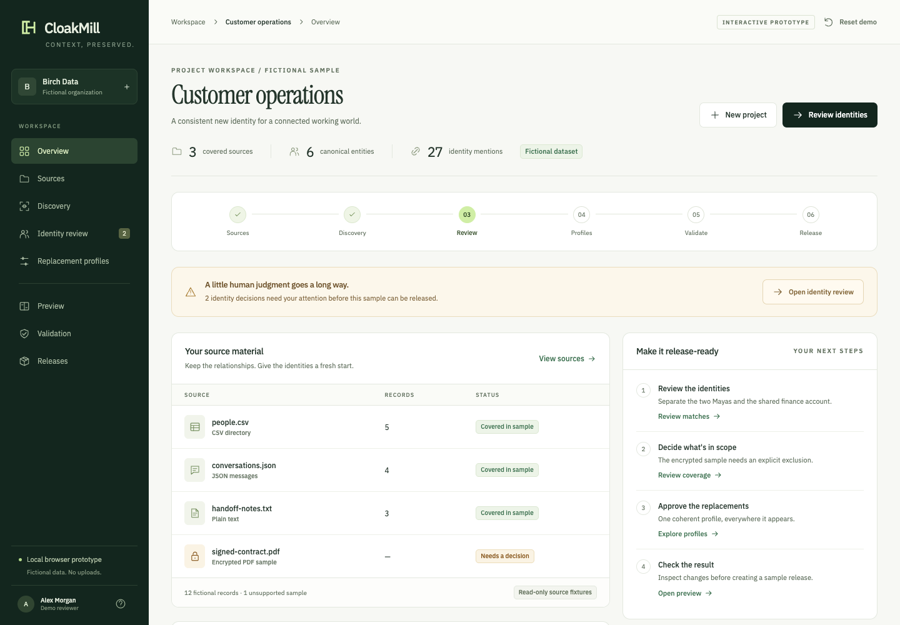

# CloakMill workspace prototype

An interactive **Step 1 UX prototype**, using fictional records and illustrative processing results. It is separate from the production application. It accepts no private files and implements no real detection, file rewriting, authentication, or privacy assessment.



## Open locally

From the repository root:

```bash
python3 -m http.server 4317 --bind 127.0.0.1 --directory prototypes/workspace
```

Open [http://127.0.0.1:4317/](http://127.0.0.1:4317/). No Node installation, build step, package install, API, or external service is required to run the UI. Fonts and their licenses are bundled locally. The HTTP server is for localhost design review, not production hosting.

## Try the complete journey

1. Open **Identity review**. Select Maya Shah for the invoice-thread mention and confirm. Keep the finance mailbox as a separate shared account.
2. In **Sources**, explicitly exclude the encrypted PDF sample.
3. In **Replacement profiles**, review the fictional identities and freeze the sample mapping.
4. Inspect several records in **Preview**. Names, emails, aliases, and organization references use the selected fictional profile.
5. In **Validation**, run the illustrative checks.
6. In **Releases**, create a sample release and download the fictional JSON bundle.

Choose **New project** to explore the empty journey, then load the sample and run its scan. **Reset demo** restores the original sample. All project data and decisions live in tab memory; reloading restores the initial fictional workspace.

## Try the difficult states

- Attempt to freeze mappings before identity decisions and source exclusions are complete.
- Choose Maya Chen for the invoice-thread mention: the authored validation scenario flags the contradiction and offers a route back to review.
- Change the replacement profile after validation: the current approval and validation are invalidated.
- Download an earlier sample release after changing the working profile: the historical payload remains unchanged.
- Submit an empty project name, dismiss a dialog with Escape, use the mobile navigation, and inspect an unsupported source.

All scan progress, findings, recommendations, and validation outcomes demonstrate the intended UX. They are authored fixture behavior, not evidence of an implemented general-purpose privacy engine.

## Verify the workflow model

With Node.js 22 or newer:

```bash
node --test prototypes/workspace/model.test.mjs
```

The tests exercise release gates, current-revision validation, source exclusions, contradictory identity choices, profile invalidation, immutable historical samples, and omission of original identities/mapping tables from the fictional download.

## Files

| File | Responsibility |
| --- | --- |
| `index.html` | Entry document, CSP, accessible dialogs, local assets |
| `styles.css` | Brand tokens, component styling, responsive and reduced-motion behavior |
| `fixtures.mjs` | Authored fictional sources, identity spans, profiles, and review cases |
| `model.mjs` | Explicit prototype transitions, release gates, and sample rendering |
| `views.mjs` | Screen templates and presentation helpers |
| `app.mjs` | Navigation, interaction binding, in-memory state, and sample download |
| `icons.mjs` | Original lightweight interface glyphs |
| `model.test.mjs` | Behavioral checks for the prototype workflow |
| `assets/fonts/` | Unmodified fonts with their original SIL OFL notices |

See the [UX workflow and review checklist](../../docs/product/ux-workflow.md). The production frontend, API contracts, authentication, and persistent data model belong to subsequent implementation steps.
